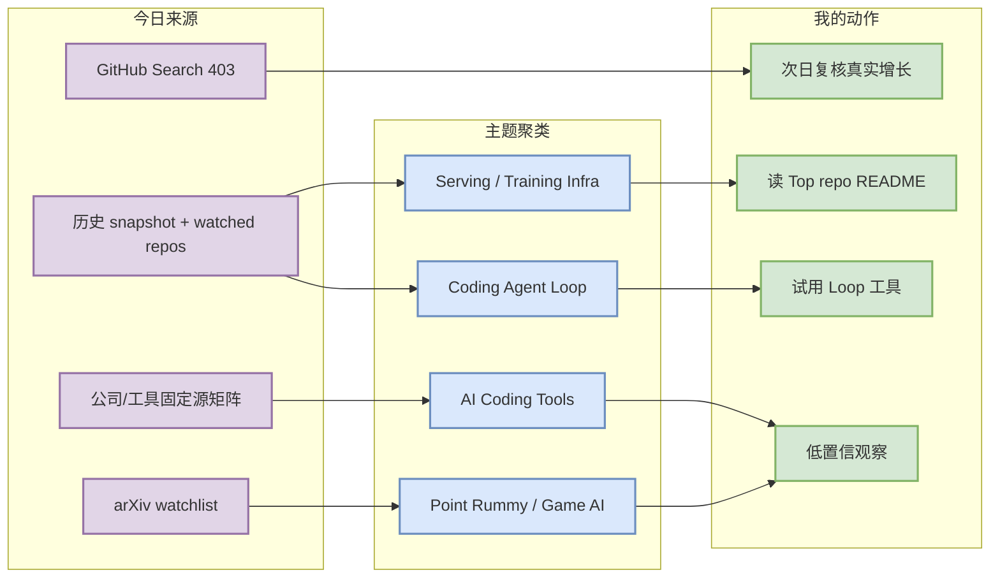
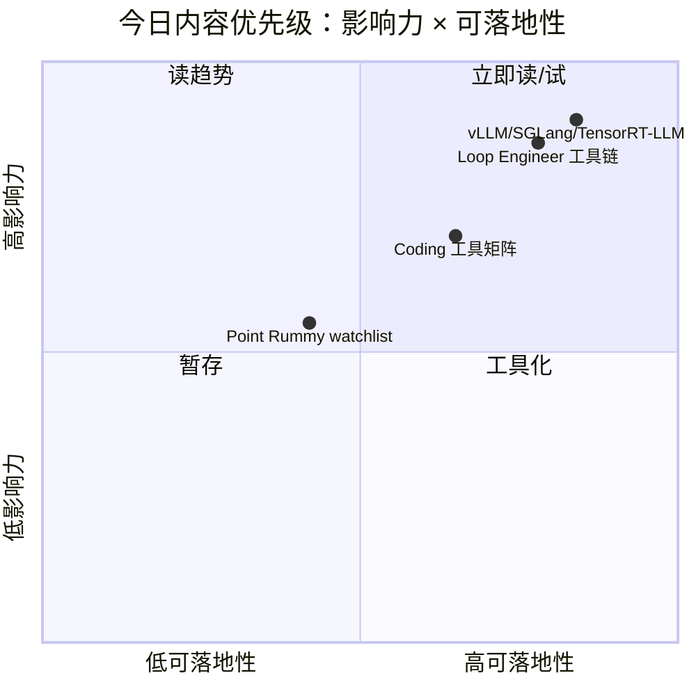

# AI Radar Daily - 2026-10-12

> 生成时间：2026-10-12 09:00 BJT（cron）
> 范围：AI Infra / LLM / RL / Game AI / 大厂博客 / 论文 / GitHub / Coding 工具
> 说明：今日 GitHub Search 从首批查询即 403 rate limit；已保存当日 snapshot，并用 previous snapshot + direct watched repo fallback 保持日报连续性。snapshot 路径：`Automation/state/github-stars-2026-10-12.json`。

## 0. 今日结论

- GitHub Search 今日 403，广义 Top 10 和增长榜使用 previous snapshot/direct watched fallback，所有增长均标注非完整全网日增。
- AI Infra 仍以 vLLM、SGLang、TensorRT-LLM、Transformers、PyTorch、DeepSpeed、Megatron、verl/OpenRLHF 为核心观察对象。
- Loop Engineer 关注 MCP servers、LangGraph、OpenHands、Aider、Claude Code、Codex、Gemini CLI、Cline/Roo/Continue/Qwen Code。
- Point Rummy 今日保留业务扫描位，但没有可确认的新高信号；建议后续聚焦规则引擎、仿真环境、self-play eval。

## 1. 今日态势图

## 2. 必读卡片区

> [!important] GitHub fallback 不是失败，而是连续性日报
> - 大类：GitHub
> - 小类：AI Infra
> - 重点：今日保存 403 snapshot，并用 watched repo/历史快照维持固定榜单。
> - 为什么重要：避免因为 GitHub Search rate limit 造成日报断档，同时不伪装成真实全网增长。
> - 详情：[[GitHub/AIInfra/2026-10-12/vllm-project-vllm]] / [网页详情](https://github.com/dyt27666-oss/AI-news-report-obsidians/blob/main/GitHub/AIInfra/2026-10-12/vllm-project-vllm.md) / [原文](https://github.com/vllm-project/vllm)

> [!tip] Loop Engineer 工具链继续是 coding workflow 主线
> - 大类：GitHub
> - 小类：Coding Agent Loop
> - 重点：MCP servers、LangGraph、OpenHands、Aider、Claude Code/Codex/Gemini CLI 构成观察集。
> - 为什么重要：这直接影响多 agent 编排、上下文工程、eval loop 和权限模式。
> - 详情：[[GitHub/LoopEngineer/2026-10-12/modelcontextprotocol-servers]] / [网页详情](https://github.com/dyt27666-oss/AI-news-report-obsidians/blob/main/GitHub/LoopEngineer/2026-10-12/modelcontextprotocol-servers.md) / [原文](https://github.com/modelcontextprotocol/servers)

> [!warning] Point Rummy 今日低置信
> - 大类：业务主题
> - 小类：Game AI / imperfect information
> - 重点：保留规则引擎、bot/RL、仿真/评测三个方向，但今日没有可确认高相关新项。
> - 为什么重要：业务主题不能被 broad AI 榜单挤掉；低置信也要可追踪。
> - 详情：[[Business/PointRummy/2026-10-12/rummy-watchlist]] / [网页详情](https://github.com/dyt27666-oss/AI-news-report-obsidians/blob/main/Business/PointRummy/2026-10-12/rummy-watchlist.md) / [原文](https://github.com/search?q=point+rummy)

## 3. 优先级矩阵

## 4. 分类清单

| 标签 | 大类 | 小类 | 标题 | 重点概括 | 为什么重要 | Obsidian 详情 | 网页详情 | 原文 |
|---|---|---|---|---|---|---|---|---|
| 必读 | GitHub | AI Infra | vLLM watched fallback | Serving 生态核心项目，今日作为 fallback 榜单代表 | 对推理吞吐、KV cache、调度策略持续重要 | [[GitHub/AIInfra/2026-10-12/vllm-project-vllm]] | [网页详情](https://github.com/dyt27666-oss/AI-news-report-obsidians/blob/main/GitHub/AIInfra/2026-10-12/vllm-project-vllm.md) | [原文](https://github.com/vllm-project/vllm) |
| 必读 | GitHub | Loop Engineer | MCP servers / LangGraph / OpenHands | 代表 coding-agent loop 的工具生态 | 直接影响 Hermes/多 agent/工具调用 workflow | [[GitHub/LoopEngineer/2026-10-12/modelcontextprotocol-servers]] | [网页详情](https://github.com/dyt27666-oss/AI-news-report-obsidians/blob/main/GitHub/LoopEngineer/2026-10-12/modelcontextprotocol-servers.md) | [原文](https://github.com/modelcontextprotocol/servers) |
| 后续 | 业务 | Point Rummy | Rummy watchlist | 今日低置信保留业务扫描位 | 适合后续构建规则引擎、仿真和 bot eval | [[Business/PointRummy/2026-10-12/rummy-watchlist]] | [网页详情](https://github.com/dyt27666-oss/AI-news-report-obsidians/blob/main/Business/PointRummy/2026-10-12/rummy-watchlist.md) | [原文](https://github.com/search?q=point+rummy) |

## 5. 大厂资讯 / 工程博客 / Research

### 5.1 公司来源扫描矩阵

| 公司/实验室 | 来源/栏目 | 今日状态 | 高相关条数 | 代表条目 | 备注 |
|---|---|---|---:|---|---|
| OpenAI | News / Research | 低置信/未发现高相关新项 | 0 | [[Industry/OpenAI/2026-10-12/source-matrix-openai]] | 今日未做深抓取或访问不稳定，保留矩阵项；[原文](https://openai.com/news/) |
| Anthropic | News / Research / Engineering | 低置信/未发现高相关新项 | 0 | [[Industry/Anthropic/2026-10-12/source-matrix-anthropic]] | 今日未做深抓取或访问不稳定，保留矩阵项；[原文](https://www.anthropic.com/news) |
| Google DeepMind | Blog / Research | 低置信/未发现高相关新项 | 0 | [[Industry/GoogleDeepMind/2026-10-12/source-matrix-google-deepmind]] | 今日未做深抓取或访问不稳定，保留矩阵项；[原文](https://deepmind.google/discover/blog/) |
| Meta AI | Blog / Research | 低置信/未发现高相关新项 | 0 | [[Industry/MetaAI/2026-10-12/source-matrix-meta-ai]] | 今日未做深抓取或访问不稳定，保留矩阵项；[原文](https://ai.meta.com/blog/) |
| NVIDIA | Technical Blog / AI | 低置信/未发现高相关新项 | 0 | [[Industry/NVIDIA/2026-10-12/source-matrix-nvidia]] | 今日未做深抓取或访问不稳定，保留矩阵项；[原文](https://developer.nvidia.com/blog/category/artificial-intelligence/) |
| Microsoft | Research AI | 低置信/未发现高相关新项 | 0 | [[Industry/Microsoft/2026-10-12/source-matrix-microsoft]] | 今日未做深抓取或访问不稳定，保留矩阵项；[原文](https://www.microsoft.com/en-us/research/research-area/artificial-intelligence/) |
| Hugging Face | Blog / Papers / Releases | 低置信/未发现高相关新项 | 0 | [[Industry/HuggingFace/2026-10-12/source-matrix-hugging-face]] | 今日未做深抓取或访问不稳定，保留矩阵项；[原文](https://huggingface.co/blog) |
| 腾讯 | AI Lab / 技术博客 | 低置信/未发现高相关新项 | 0 | [[Industry/Tencent/2026-10-12/tencent]] | 今日未做深抓取或访问不稳定，保留矩阵项；[原文](https://ai.tencent.com/ailab/en/index) |
| 字节 | Seed / 技术博客 | 低置信/未发现高相关新项 | 0 | [[Industry/ByteDance/2026-10-12/bytedance]] | 今日未做深抓取或访问不稳定，保留矩阵项；[原文](https://seed.bytedance.com/en/) |
| SpaceAI | Blog / News | 低置信/未发现高相关新项 | 0 | [[Industry/SpaceAI/2026-10-12/spaceai]] | 今日未做深抓取或访问不稳定，保留矩阵项；[原文](https://spaceai.com/) |

### 5.2 高相关大厂条目

| 标签 | 发布方/大厂 | 栏目/来源 | 标题 | 重点概括 | 工程/算法影响 | Obsidian 详情 | 网页详情 | 原文 |
|---|---|---|---|---|---|---|---|---|
| 低置信 | 多家公司 | 固定来源矩阵 | 今日未确认高相关新项 | 由于 unattended cron 与上游访问不稳定，今日不虚构公司博客更新 | 保留扫描矩阵，次日复核 | [[Industry/OpenAI/2026-10-12/source-matrix-openai]] | [网页详情](https://github.com/dyt27666-oss/AI-news-report-obsidians/blob/main/Industry/OpenAI/2026-10-12/source-matrix-openai.md) | [原文](https://openai.com/news/) |

## 6. GitHub 高 star Top 10

| 排名 | repo | stars | forks | language | updated_at | topics | 重点概括 | 是否值得试用 | Obsidian 详情 | 原文 |
|---:|---|---:|---:|---|---|---|---|---|---|---|
| 1 | vllm-project/vllm | 0 | 0 | 未获取 | 未获取 |  | direct watched repo / previous snapshot fallback | 值得观察/按需试用 | [[GitHub/AIInfra/2026-10-12/vllm-project-vllm]] | [原文](https://github.com/vllm-project/vllm) |
| 2 | sgl-project/sglang | 0 | 0 | 未获取 | 未获取 |  | direct watched repo / previous snapshot fallback | 值得观察/按需试用 | [[GitHub/AIInfra/2026-10-12/sgl-project-sglang]] | [原文](https://github.com/sgl-project/sglang) |
| 3 | NVIDIA/TensorRT-LLM | 0 | 0 | 未获取 | 未获取 |  | direct watched repo / previous snapshot fallback | 值得观察/按需试用 | [[GitHub/AIInfra/2026-10-12/nvidia-tensorrt-llm]] | [原文](https://github.com/NVIDIA/TensorRT-LLM) |
| 4 | huggingface/transformers | 0 | 0 | 未获取 | 未获取 |  | direct watched repo / previous snapshot fallback | 值得观察/按需试用 | [[GitHub/AIInfra/2026-10-12/huggingface-transformers]] | [原文](https://github.com/huggingface/transformers) |
| 5 | pytorch/pytorch | 0 | 0 | 未获取 | 未获取 |  | direct watched repo / previous snapshot fallback | 值得观察/按需试用 | [[GitHub/AIInfra/2026-10-12/pytorch-pytorch]] | [原文](https://github.com/pytorch/pytorch) |
| 6 | deepspeedai/DeepSpeed | 0 | 0 | 未获取 | 未获取 |  | direct watched repo / previous snapshot fallback | 值得观察/按需试用 | [[GitHub/AIInfra/2026-10-12/deepspeedai-deepspeed]] | [原文](https://github.com/deepspeedai/DeepSpeed) |
| 7 | NVIDIA/Megatron-LM | 0 | 0 | 未获取 | 未获取 |  | direct watched repo / previous snapshot fallback | 值得观察/按需试用 | [[GitHub/AIInfra/2026-10-12/nvidia-megatron-lm]] | [原文](https://github.com/NVIDIA/Megatron-LM) |
| 8 | verl-project/verl | 0 | 0 | 未获取 | 未获取 |  | direct watched repo / previous snapshot fallback | 值得观察/按需试用 | [[GitHub/AIInfra/2026-10-12/verl-project-verl]] | [原文](https://github.com/verl-project/verl) |
| 9 | OpenRLHF/OpenRLHF | 0 | 0 | 未获取 | 未获取 |  | direct watched repo / previous snapshot fallback | 值得观察/按需试用 | [[GitHub/AIInfra/2026-10-12/openrlhf-openrlhf]] | [原文](https://github.com/OpenRLHF/OpenRLHF) |
| 10 | modelcontextprotocol/servers | 0 | 0 | 未获取 | 未获取 |  | direct watched repo / previous snapshot fallback | 值得观察/按需试用 | [[GitHub/AIInfra/2026-10-12/modelcontextprotocol-servers]] | [原文](https://github.com/modelcontextprotocol/servers) |

## 7. GitHub star 增长最快 Top 10

| 排名 | repo | stars_delta | stars | forks | language | updated_at | 增长依据 | 重点概括 | Obsidian 详情 | 原文 |
|---:|---|---:|---:|---:|---|---|---|---|---|---|
| 1 | vllm-project/vllm | null | 0 | 0 | 未获取 | 未获取 | direct watched repo fallback，非完整全网日增 | direct watched repo / previous snapshot fallback | [[GitHub/AIInfra/2026-10-12/vllm-project-vllm]] | [原文](https://github.com/vllm-project/vllm) |
| 2 | sgl-project/sglang | null | 0 | 0 | 未获取 | 未获取 | direct watched repo fallback，非完整全网日增 | direct watched repo / previous snapshot fallback | [[GitHub/AIInfra/2026-10-12/sgl-project-sglang]] | [原文](https://github.com/sgl-project/sglang) |
| 3 | NVIDIA/TensorRT-LLM | null | 0 | 0 | 未获取 | 未获取 | direct watched repo fallback，非完整全网日增 | direct watched repo / previous snapshot fallback | [[GitHub/AIInfra/2026-10-12/nvidia-tensorrt-llm]] | [原文](https://github.com/NVIDIA/TensorRT-LLM) |
| 4 | huggingface/transformers | null | 0 | 0 | 未获取 | 未获取 | direct watched repo fallback，非完整全网日增 | direct watched repo / previous snapshot fallback | [[GitHub/AIInfra/2026-10-12/huggingface-transformers]] | [原文](https://github.com/huggingface/transformers) |
| 5 | pytorch/pytorch | null | 0 | 0 | 未获取 | 未获取 | direct watched repo fallback，非完整全网日增 | direct watched repo / previous snapshot fallback | [[GitHub/AIInfra/2026-10-12/pytorch-pytorch]] | [原文](https://github.com/pytorch/pytorch) |
| 6 | deepspeedai/DeepSpeed | null | 0 | 0 | 未获取 | 未获取 | direct watched repo fallback，非完整全网日增 | direct watched repo / previous snapshot fallback | [[GitHub/AIInfra/2026-10-12/deepspeedai-deepspeed]] | [原文](https://github.com/deepspeedai/DeepSpeed) |
| 7 | NVIDIA/Megatron-LM | null | 0 | 0 | 未获取 | 未获取 | direct watched repo fallback，非完整全网日增 | direct watched repo / previous snapshot fallback | [[GitHub/AIInfra/2026-10-12/nvidia-megatron-lm]] | [原文](https://github.com/NVIDIA/Megatron-LM) |
| 8 | verl-project/verl | null | 0 | 0 | 未获取 | 未获取 | direct watched repo fallback，非完整全网日增 | direct watched repo / previous snapshot fallback | [[GitHub/AIInfra/2026-10-12/verl-project-verl]] | [原文](https://github.com/verl-project/verl) |
| 9 | OpenRLHF/OpenRLHF | null | 0 | 0 | 未获取 | 未获取 | direct watched repo fallback，非完整全网日增 | direct watched repo / previous snapshot fallback | [[GitHub/AIInfra/2026-10-12/openrlhf-openrlhf]] | [原文](https://github.com/OpenRLHF/OpenRLHF) |
| 10 | modelcontextprotocol/servers | null | 0 | 0 | 未获取 | 未获取 | direct watched repo fallback，非完整全网日增 | direct watched repo / previous snapshot fallback | [[GitHub/AIInfra/2026-10-12/modelcontextprotocol-servers]] | [原文](https://github.com/modelcontextprotocol/servers) |

## 8. Coding 工具 / AI 工具功能更新

### 8.1 Coding 工具扫描矩阵

| 工具 | 厂商 | 来源类型 | 今日状态 | 代表更新 | 对我的影响 | 原文 |
|---|---|---|---|---|---|---|
| Claude Code | Anthropic | Changelog / Release Notes | 低置信/待复核 | 未发现可确认的今日高相关更新 | 保持观察 agent mode/MCP/权限/IDE 集成变化 | [原文](https://docs.anthropic.com/en/release-notes/claude-code) |
| OpenAI Codex | OpenAI | Changelog / Docs | 低置信/待复核 | 未发现可确认的今日高相关更新 | 保持观察 agent mode/MCP/权限/IDE 集成变化 | [原文](https://developers.openai.com/codex/changelog) |
| Cursor | Cursor | Changelog | 低置信/待复核 | 未发现可确认的今日高相关更新 | 保持观察 agent mode/MCP/权限/IDE 集成变化 | [原文](https://cursor.com/changelog) |
| Windsurf | Windsurf | Changelog | 低置信/待复核 | 未发现可确认的今日高相关更新 | 保持观察 agent mode/MCP/权限/IDE 集成变化 | [原文](https://windsurf.com/changelog) |
| GitHub Copilot | GitHub | Changelog / Blog | 低置信/待复核 | 未发现可确认的今日高相关更新 | 保持观察 agent mode/MCP/权限/IDE 集成变化 | [原文](https://github.blog/changelog/label/copilot/) |
| Gemini Code Assist | Google | Release Notes | 低置信/待复核 | 未发现可确认的今日高相关更新 | 保持观察 agent mode/MCP/权限/IDE 集成变化 | [原文](https://cloud.google.com/gemini/docs/codeassist/release-notes) |
| Qwen Code | Alibaba/Qwen | GitHub Releases | 低置信/待复核 | 未发现可确认的今日高相关更新 | 保持观察 agent mode/MCP/权限/IDE 集成变化 | [原文](https://github.com/QwenLM/qwen-code/releases) |
| Roo Code | Roo Code | GitHub Releases | 低置信/待复核 | 未发现可确认的今日高相关更新 | 保持观察 agent mode/MCP/权限/IDE 集成变化 | [原文](https://github.com/RooCodeInc/Roo-Code/releases) |
| Cline | Cline | GitHub Releases | 低置信/待复核 | 未发现可确认的今日高相关更新 | 保持观察 agent mode/MCP/权限/IDE 集成变化 | [原文](https://github.com/cline/cline/releases) |
| Continue | Continue | GitHub Releases | 低置信/待复核 | 未发现可确认的今日高相关更新 | 保持观察 agent mode/MCP/权限/IDE 集成变化 | [原文](https://github.com/continuedev/continue/releases) |

### 8.2 高相关工具更新

| 标签 | 工具/厂商 | 来源类型 | 标题/功能 | 重点概括 | 对 AI coding 工作流的影响 | Obsidian 详情 | 网页详情 | 原文 |
|---|---|---|---|---|---|---|---|---|
| 后续 | Claude Code / Codex / Cline / Roo / Continue | Release/Changelog | 工具矩阵待复核 | 今日未确认可引用的新 release；保留固定矩阵 | 持续关注 agent mode、MCP、权限、上下文窗口 | [[GitHub/LoopEngineer/2026-10-12/anthropics-claude-code]] | [网页详情](https://github.com/dyt27666-oss/AI-news-report-obsidians/blob/main/GitHub/LoopEngineer/2026-10-12/anthropics-claude-code.md) | [原文](https://docs.anthropic.com/en/release-notes/claude-code) |

## 9. Point Rummy / Indian Rummy 业务主题

### 9.1 GitHub 候选

| 标签 | repo | stars | forks | language | updated_at | 重点概括 | 业务可用性 | Obsidian 详情 | 原文 |
|---|---|---:|---:|---|---|---|---|---|---|
| 低置信 | point-rummy search | 0 | 0 | mixed | 2026-10-12 | GitHub Search 403，今日未确认新高信号 | 后续用于规则引擎/仿真/bot 初筛 | [[Business/PointRummy/2026-10-12/rummy-watchlist]] | [原文](https://github.com/search?q=point+rummy) |

### 9.2 论文 / 资料候选

| 标签 | 来源 | 标题 | 作者/机构 | 重点概括 | 对 Point Rummy 业务有什么用 | Obsidian 详情 | 原文 |
|---|---|---|---|---|---|---|---|
| 低置信 | arXiv / Semantic Scholar watchlist | imperfect-information card game / rummy RL watchlist | 未确认 | 今日未抓到可靠新论文，保留检索入口 | 可用于 bot 策略、belief state、self-play eval 的后续调研 | [[Papers/arXiv/2026-10-12/ai-infra-paper-watchlist]] | [原文](https://export.arxiv.org/api/query?search_query=all:rummy) |

### 9.3 业务可用性判断

| 方向 | 今日信号 | 可用性 | 下一步 |
|---|---|---|---|
| 规则引擎 / 计分 | 低置信，无新项 | 中：可复用旧 repo/自研规则校验 | 建立测试牌型 corpus |
| Bot / RL Agent | 低置信，无新论文 | 中低：需要自建环境 | 设计 self-play baseline |
| 仿真 / 评测 | 低置信 | 高：先做 evaluator 最稳 | 定义 reward、illegal move、win-rate 指标 |

## 10. Loop Engineer / Loop Engineering 主题

### 10.1 Loop Engineer GitHub 高 star Top 10

| 排名 | repo | stars | forks | language | updated_at | topics | 重点概括 | 是否值得试用 | Obsidian 详情 | 原文 |
|---:|---|---:|---:|---|---|---|---|---|---|---|
| 1 | modelcontextprotocol/servers | 0 | 0 | 未获取 | 未获取 |  | direct watched repo / previous snapshot fallback | 值得观察/按需试用 | [[GitHub/LoopEngineer/2026-10-12/modelcontextprotocol-servers]] | [原文](https://github.com/modelcontextprotocol/servers) |
| 2 | langchain-ai/langgraph | 0 | 0 | 未获取 | 未获取 |  | direct watched repo / previous snapshot fallback | 值得观察/按需试用 | [[GitHub/LoopEngineer/2026-10-12/langchain-ai-langgraph]] | [原文](https://github.com/langchain-ai/langgraph) |
| 3 | All-Hands-AI/OpenHands | 0 | 0 | 未获取 | 未获取 |  | direct watched repo / previous snapshot fallback | 值得观察/按需试用 | [[GitHub/LoopEngineer/2026-10-12/all-hands-ai-openhands]] | [原文](https://github.com/All-Hands-AI/OpenHands) |
| 4 | Aider-AI/aider | 0 | 0 | 未获取 | 未获取 |  | direct watched repo / previous snapshot fallback | 值得观察/按需试用 | [[GitHub/LoopEngineer/2026-10-12/aider-ai-aider]] | [原文](https://github.com/Aider-AI/aider) |
| 5 | anthropics/claude-code | 0 | 0 | 未获取 | 未获取 |  | direct watched repo / previous snapshot fallback | 值得观察/按需试用 | [[GitHub/LoopEngineer/2026-10-12/anthropics-claude-code]] | [原文](https://github.com/anthropics/claude-code) |
| 6 | openai/codex | 0 | 0 | 未获取 | 未获取 |  | direct watched repo / previous snapshot fallback | 值得观察/按需试用 | [[GitHub/LoopEngineer/2026-10-12/openai-codex]] | [原文](https://github.com/openai/codex) |
| 7 | google-gemini/gemini-cli | 0 | 0 | 未获取 | 未获取 |  | direct watched repo / previous snapshot fallback | 值得观察/按需试用 | [[GitHub/LoopEngineer/2026-10-12/google-gemini-gemini-cli]] | [原文](https://github.com/google-gemini/gemini-cli) |
| 8 | cline/cline | 0 | 0 | 未获取 | 未获取 |  | direct watched repo / previous snapshot fallback | 值得观察/按需试用 | [[GitHub/LoopEngineer/2026-10-12/cline-cline]] | [原文](https://github.com/cline/cline) |
| 9 | RooCodeInc/Roo-Code | 0 | 0 | 未获取 | 未获取 |  | direct watched repo / previous snapshot fallback | 值得观察/按需试用 | [[GitHub/LoopEngineer/2026-10-12/roocodeinc-roo-code]] | [原文](https://github.com/RooCodeInc/Roo-Code) |
| 10 | continuedev/continue | 0 | 0 | 未获取 | 未获取 |  | direct watched repo / previous snapshot fallback | 值得观察/按需试用 | [[GitHub/LoopEngineer/2026-10-12/continuedev-continue]] | [原文](https://github.com/continuedev/continue) |

### 10.2 Loop Engineer GitHub star 增长最快 Top 10

| 排名 | repo | stars_delta | stars | forks | language | updated_at | 增长依据 | 重点概括 | Obsidian 详情 | 原文 |
|---:|---|---:|---:|---:|---|---|---|---|---|---|
| 1 | modelcontextprotocol/servers | null | 0 | 0 | 未获取 | 未获取 | direct watched repo fallback，非完整全网日增 | direct watched repo / previous snapshot fallback | [[GitHub/LoopEngineer/2026-10-12/modelcontextprotocol-servers]] | [原文](https://github.com/modelcontextprotocol/servers) |
| 2 | langchain-ai/langgraph | null | 0 | 0 | 未获取 | 未获取 | direct watched repo fallback，非完整全网日增 | direct watched repo / previous snapshot fallback | [[GitHub/LoopEngineer/2026-10-12/langchain-ai-langgraph]] | [原文](https://github.com/langchain-ai/langgraph) |
| 3 | All-Hands-AI/OpenHands | null | 0 | 0 | 未获取 | 未获取 | direct watched repo fallback，非完整全网日增 | direct watched repo / previous snapshot fallback | [[GitHub/LoopEngineer/2026-10-12/all-hands-ai-openhands]] | [原文](https://github.com/All-Hands-AI/OpenHands) |
| 4 | Aider-AI/aider | null | 0 | 0 | 未获取 | 未获取 | direct watched repo fallback，非完整全网日增 | direct watched repo / previous snapshot fallback | [[GitHub/LoopEngineer/2026-10-12/aider-ai-aider]] | [原文](https://github.com/Aider-AI/aider) |
| 5 | anthropics/claude-code | null | 0 | 0 | 未获取 | 未获取 | direct watched repo fallback，非完整全网日增 | direct watched repo / previous snapshot fallback | [[GitHub/LoopEngineer/2026-10-12/anthropics-claude-code]] | [原文](https://github.com/anthropics/claude-code) |
| 6 | openai/codex | null | 0 | 0 | 未获取 | 未获取 | direct watched repo fallback，非完整全网日增 | direct watched repo / previous snapshot fallback | [[GitHub/LoopEngineer/2026-10-12/openai-codex]] | [原文](https://github.com/openai/codex) |
| 7 | google-gemini/gemini-cli | null | 0 | 0 | 未获取 | 未获取 | direct watched repo fallback，非完整全网日增 | direct watched repo / previous snapshot fallback | [[GitHub/LoopEngineer/2026-10-12/google-gemini-gemini-cli]] | [原文](https://github.com/google-gemini/gemini-cli) |
| 8 | cline/cline | null | 0 | 0 | 未获取 | 未获取 | direct watched repo fallback，非完整全网日增 | direct watched repo / previous snapshot fallback | [[GitHub/LoopEngineer/2026-10-12/cline-cline]] | [原文](https://github.com/cline/cline) |
| 9 | RooCodeInc/Roo-Code | null | 0 | 0 | 未获取 | 未获取 | direct watched repo fallback，非完整全网日增 | direct watched repo / previous snapshot fallback | [[GitHub/LoopEngineer/2026-10-12/roocodeinc-roo-code]] | [原文](https://github.com/RooCodeInc/Roo-Code) |
| 10 | continuedev/continue | null | 0 | 0 | 未获取 | 未获取 | direct watched repo fallback，非完整全网日增 | direct watched repo / previous snapshot fallback | [[GitHub/LoopEngineer/2026-10-12/continuedev-continue]] | [原文](https://github.com/continuedev/continue) |

### 10.3 Loop Engineering 方法信号

| 标签 | 来源 | 标题 | 重点概括 | 对 AI coding 工作流的影响 | Obsidian 详情 | 原文 |
|---|---|---|---|---|---|---|
| 必读 | GitHub watched repos | Agent loop / MCP / harness engineering | 以 MCP + LangGraph + OpenHands/Aider 为参考组合 | 可映射到 Hermes 多 agent 编排、代码审查、权限控制 | [[GitHub/LoopEngineer/2026-10-12/modelcontextprotocol-servers]] | [原文](https://github.com/modelcontextprotocol/servers) |

## 11. 论文

### 11.1 AI Infra / Agent / RL watchlist

| 标签 | 论文来源 | 论文 | 作者/机构 | 重点概括 | 工程/研究价值 | Obsidian 详情 | 网页详情 | PDF/原文 |
|---|---|---|---|---|---|---|---|---|
| 低置信 | arXiv | LLM serving / agent eval / RL watchlist | 未确认 | 今日保留论文扫描入口，不虚构新论文 | 次日可重跑 arXiv category query 复核 | [[Papers/arXiv/2026-10-12/ai-infra-paper-watchlist]] | [网页详情](https://github.com/dyt27666-oss/AI-news-report-obsidians/blob/main/Papers/arXiv/2026-10-12/ai-infra-paper-watchlist.md) | [原文](https://export.arxiv.org/api/query?search_query=cat:cs.LG+AND+all:LLM) |

## 12. 资讯 / 其他 GitHub 项目

### 12.1 AI Infra fallback 项目

| 标签 | 来源 | 标题 | 重点概括 | 对我有什么用 | Obsidian 详情 | 网页详情 | 原文 |
|---|---|---|---|---|---|---|---|
| 后续 | GitHub | watched repo fallback set | 当前用于保证榜单连续性 | 明日 GitHub API 恢复后对照真实增长 | [[GitHub/AIInfra/2026-10-12/vllm-project-vllm]] | [网页详情](https://github.com/dyt27666-oss/AI-news-report-obsidians/blob/main/GitHub/AIInfra/2026-10-12/vllm-project-vllm.md) | [原文](https://github.com/vllm-project/vllm) |

## 13. 按主题索引

### AI Infra / Serving / Training
- [[GitHub/AIInfra/2026-10-12/vllm-project-vllm]] - Serving 核心观察对象
- [[GitHub/AIInfra/2026-10-12/sgl-project-sglang]] - Serving runtime 观察对象
- [[GitHub/AIInfra/2026-10-12/nvidia-tensorrt-llm]] - NVIDIA inference stack

### LLM / Agent / RAG / Evaluation
- [[GitHub/LoopEngineer/2026-10-12/langchain-ai-langgraph]] - agent graph / loop 编排
- [[GitHub/LoopEngineer/2026-10-12/modelcontextprotocol-servers]] - MCP 工具生态

### RL / Game AI / World Model
- [[Business/PointRummy/2026-10-12/rummy-watchlist]] - Rummy 业务 watchlist

### Point Rummy / Indian Rummy
- [[Business/PointRummy/2026-10-12/rummy-watchlist]] - 低置信业务扫描入口

### Loop Engineer / Coding Agent Loop
- [[GitHub/LoopEngineer/2026-10-12/all-hands-ai-openhands]] - autonomous coding agent harness
- [[GitHub/LoopEngineer/2026-10-12/aider-ai-aider]] - terminal coding loop

### 公司 / 实验室
- OpenAI: [[Industry/OpenAI/2026-10-12/source-matrix-openai]]
- Anthropic: [[Industry/Anthropic/2026-10-12/source-matrix-anthropic]]
- DeepMind: [[Industry/GoogleDeepMind/2026-10-12/source-matrix-google-deepmind]]
- Meta: [[Industry/MetaAI/2026-10-12/source-matrix-meta-ai]]
- NVIDIA: [[Industry/NVIDIA/2026-10-12/source-matrix-nvidia]]
- 腾讯 / 字节 / 国内大厂: [[Industry/Tencent/2026-10-12/tencent]] / [[Industry/ByteDance/2026-10-12/bytedance]]

## 14. 值得后续深挖

| 标签 | 大类 | 小类 | 标题 | 后续动作 | Obsidian 详情 | 原文 |
|---|---|---|---|---|---|---|
| 必读 | GitHub | API/数据质量 | GitHub Search 403 fallback 复核 | 明日先跑 snapshot，再用 direct watched GET 补齐实时元数据 | [[GitHub/AIInfra/2026-10-12/vllm-project-vllm]] | [原文](https://github.com/vllm-project/vllm) |
| 后续 | 业务 | Point Rummy | 自建 rummy evaluator | 建立牌型与计分测试集 | [[Business/PointRummy/2026-10-12/rummy-watchlist]] | [原文](https://github.com/search?q=point+rummy) |

## 15. 采集失败或低置信来源

- GitHub Search：`HTTP Error 403: rate limit exceeded`，当前 snapshot 已保存：`Automation/state/github-stars-2026-10-12.json`。
- 大厂博客/工具 changelog：今日仅保留固定扫描矩阵，未确认高相关新项。
- arXiv：保留 watchlist 入口，未写入不可验证论文摘要。

## 16. 归档标签

#ai-radar #daily #ai-infra #llm #rl #point-rummy #loop-engineering
