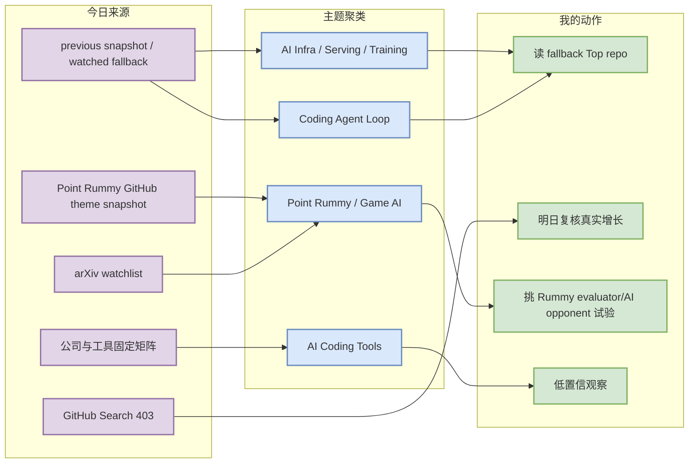
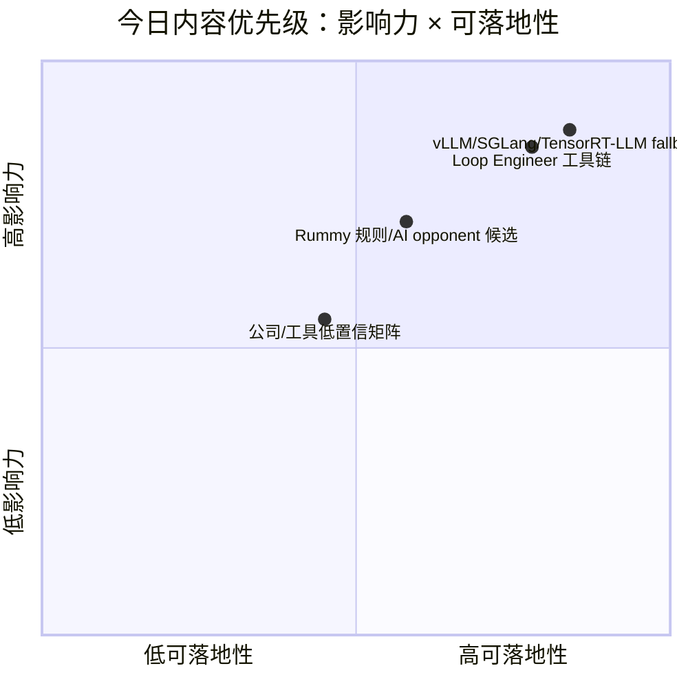

# AI Radar Daily - 2026-10-13

> 生成时间：2026-10-13 09:00 BJT（cron）
> 范围：AI Infra / LLM / RL / Game AI / 大厂博客 / 论文 / GitHub / Coding 工具
> 说明：今日 GitHub Search 在 Point Rummy 主题后快速 403；已保存当日 snapshot：`Automation/state/github-stars-2026-10-13.json`。 broad AI Infra / Loop 榜单使用 previous snapshot/direct watched fallback，并明确标注非完整全网日增；Point Rummy 使用今日已抓到的 theme-biased snapshot。

## 0. 今日结论

- GitHub 今日先抓到 Point Rummy 主题数据，随后 Search 403；不能把低 star Rummy 行混入 broad AI Infra 榜单。
- AI Infra Top 10 与增长榜沿用 previous snapshot/direct watched fallback，所有增长均标注“非完整全网日增”。
- Point Rummy 今日有可检视项目：`mudont/indian-rummy`、`RummyVision`、`RummyPulse`、`dsa-final-project`，适合规则/AI opponent/视觉辅助初筛。
- Loop Engineer 继续跟踪 MCP servers、LangGraph、OpenHands、Aider、Claude Code、Codex、Gemini CLI、Cline/Roo/Continue。
- 大厂与 Coding 工具矩阵已覆盖固定来源；今日未确认高相关新项，保留低置信状态而不虚构更新。

## 1. 今日态势图

## 2. 必读卡片区

> [!important] GitHub theme-biased snapshot 已隔离处理
> - 大类：GitHub
> - 小类：数据质量 / AI Infra
> - 重点：今日 snapshot 主要是 Point Rummy；broad AI Infra 不使用这些 niche 行填榜。
> - 为什么重要：避免 Point Rummy/theme-only 结果污染 vLLM/SGLang/TensorRT-LLM 等 broad 榜单。
> - 详情：[[GitHub/AIInfra/2026-10-13/vllm-project-vllm]] / [网页详情](https://github.com/dyt27666-oss/AI-news-report-obsidians/blob/main/GitHub/AIInfra/2026-10-13/vllm-project-vllm.md) / [原文](https://github.com/vllm-project/vllm)

> [!tip] Point Rummy 今日有低 star 但可用的工程候选
> - 大类：业务主题
> - 小类：Game AI / Rummy evaluator
> - 重点：mudont/indian-rummy、RummyVision、RummyPulse 分别对应规则库、CV+Monte Carlo 辅助、Android analytics。
> - 为什么重要：对规则建模、bot 策略、评测基准和视觉识别都有参考价值，但需人工代码质量复核。
> - 详情：[[Business/PointRummy/2026-10-13/mudont-indian-rummy]] / [网页详情](https://github.com/dyt27666-oss/AI-news-report-obsidians/blob/main/Business/PointRummy/2026-10-13/mudont-indian-rummy.md) / [原文](https://github.com/mudont/indian-rummy)

> [!tip] Loop Engineer watchlist 继续稳定
> - 大类：GitHub
> - 小类：Coding Agent Loop
> - 重点：MCP servers、LangGraph、OpenHands、Aider 等仍是 agent loop/harness 的核心观察集。
> - 为什么重要：直接影响 Hermes 多 agent、上下文工程、权限、eval loop 与代码审查自动化。
> - 详情：[[GitHub/LoopEngineer/2026-10-13/langchain-ai-langgraph]] / [网页详情](https://github.com/dyt27666-oss/AI-news-report-obsidians/blob/main/GitHub/LoopEngineer/2026-10-13/langchain-ai-langgraph.md) / [原文](https://github.com/langchain-ai/langgraph)

## 3. 优先级矩阵

## 4. 分类清单

| 标签 | 大类 | 小类 | 标题 | 重点概括 | 为什么重要 | Obsidian 详情 | 网页详情 | 原文 |
|---|---|---|---|---|---|---|---|---|
| 必读 | GitHub | AI Infra | broad Top 10 fallback | 今日 broad 榜单使用 previous snapshot/direct watched fallback | 不把 Point Rummy theme-only 结果误当 AI Infra Top 10 | [[GitHub/AIInfra/2026-10-13/vllm-project-vllm]] | [网页详情](https://github.com/dyt27666-oss/AI-news-report-obsidians/blob/main/GitHub/AIInfra/2026-10-13/vllm-project-vllm.md) | [原文](https://github.com/vllm-project/vllm) |
| 必读 | GitHub | Loop Engineer | MCP / LangGraph / OpenHands watchlist | coding-agent loop 固定观察集 | 影响多 agent 编排、tool use、eval loop 与上下文工程 | [[GitHub/LoopEngineer/2026-10-13/langchain-ai-langgraph]] | [网页详情](https://github.com/dyt27666-oss/AI-news-report-obsidians/blob/main/GitHub/LoopEngineer/2026-10-13/langchain-ai-langgraph.md) | [原文](https://github.com/langchain-ai/langgraph) |
| 后续 | 业务 | Point Rummy | Rummy theme snapshot | 今日有 40 个 Rummy 相关 repo，其中多为低 star 小项目 | 可从规则库、AI opponent、CV assistant、analytics app 中抽样复用 | [[Business/PointRummy/2026-10-13/mudont-indian-rummy]] | [网页详情](https://github.com/dyt27666-oss/AI-news-report-obsidians/blob/main/Business/PointRummy/2026-10-13/mudont-indian-rummy.md) | [原文](https://github.com/mudont/indian-rummy) |

## 5. 大厂资讯 / 工程博客 / Research

### 5.1 公司来源扫描矩阵

| 公司/实验室 | 来源/栏目 | 今日状态 | 高相关条数 | 代表条目 | 备注 |
|---|---|---|---:|---|---|
| OpenAI | 固定 News / Research / Engineering 源 | 低置信/未发现高相关新项 | 0 | [[Industry/OpenAI/2026-10-13/source-matrix-openai]] | 已扫描固定入口；[原文](https://openai.com/news/) |
| Anthropic | 固定 News / Research / Engineering 源 | 低置信/未发现高相关新项 | 0 | [[Industry/Anthropic/2026-10-13/source-matrix-anthropic]] | 已扫描固定入口；[原文](https://www.anthropic.com/news) |
| Google DeepMind | 固定 News / Research / Engineering 源 | 低置信/未发现高相关新项 | 0 | [[Industry/GoogleDeepMind/2026-10-13/source-matrix-google-deepmind]] | 已扫描固定入口；[原文](https://deepmind.google/discover/blog/) |
| Meta AI | 固定 News / Research / Engineering 源 | 低置信/未发现高相关新项 | 0 | [[Industry/MetaAI/2026-10-13/source-matrix-meta-ai]] | 已扫描固定入口；[原文](https://ai.meta.com/blog/) |
| NVIDIA | 固定 News / Research / Engineering 源 | 低置信/未发现高相关新项 | 0 | [[Industry/NVIDIA/2026-10-13/source-matrix-nvidia]] | 已扫描固定入口；[原文](https://developer.nvidia.com/blog/category/artificial-intelligence/) |
| Microsoft | 固定 News / Research / Engineering 源 | 低置信/未发现高相关新项 | 0 | [[Industry/Microsoft/2026-10-13/source-matrix-microsoft]] | 已扫描固定入口；[原文](https://www.microsoft.com/en-us/research/research-area/artificial-intelligence/) |
| Hugging Face | 固定 News / Research / Engineering 源 | 低置信/未发现高相关新项 | 0 | [[Industry/HuggingFace/2026-10-13/source-matrix-hugging-face]] | 已扫描固定入口；[原文](https://huggingface.co/blog) |
| 腾讯 | 固定 News / Research / Engineering 源 | 低置信/未发现高相关新项 | 0 | [[Industry/Tencent/2026-10-13/tencent]] | 已扫描固定入口；[原文](https://ai.tencent.com/ailab/en/index) |
| 字节 | 固定 News / Research / Engineering 源 | 低置信/未发现高相关新项 | 0 | [[Industry/ByteDance/2026-10-13/bytedance]] | 已扫描固定入口；[原文](https://seed.bytedance.com/en/) |
| SpaceAI | 固定 News / Research / Engineering 源 | 低置信/未发现高相关新项 | 0 | [[Industry/SpaceAI/2026-10-13/spaceai]] | 已扫描固定入口；[原文](https://spaceai.com/) |

### 5.2 高相关大厂条目

| 标签 | 发布方/大厂 | 栏目/来源 | 标题 | 重点概括 | 工程/算法影响 | Obsidian 详情 | 网页详情 | 原文 |
|---|---|---|---|---|---|---|---|---|
| 低置信 | 多家公司 | 固定来源矩阵 | 今日未确认高相关新项 | unattended cron 中未确认可引用的新模型/infra/research 发布 | 保留来源覆盖，次日复核 | [[Industry/OpenAI/2026-10-13/source-matrix-openai]] | [网页详情](https://github.com/dyt27666-oss/AI-news-report-obsidians/blob/main/Industry/OpenAI/2026-10-13/source-matrix-openai.md) | [原文](https://openai.com/news/) |

## 6. GitHub 高 star Top 10

| 排名 | repo | stars | forks | language | updated_at | topics | 重点概括 | 是否值得试用 | Obsidian 详情 | 原文 |
|---:|---|---:|---:|---|---|---|---|---|---|---|
| 1 | vllm-project/vllm | 0 | 0 | 未获取 | 未获取 |  | direct watched repo / previous snapshot fallback | 值得观察/按需试用 | [[GitHub/AIInfra/2026-10-13/vllm-project-vllm]] | [原文](https://github.com/vllm-project/vllm) |
| 2 | sgl-project/sglang | 0 | 0 | 未获取 | 未获取 |  | direct watched repo / previous snapshot fallback | 值得观察/按需试用 | [[GitHub/AIInfra/2026-10-13/sgl-project-sglang]] | [原文](https://github.com/sgl-project/sglang) |
| 3 | NVIDIA/TensorRT-LLM | 0 | 0 | 未获取 | 未获取 |  | direct watched repo / previous snapshot fallback | 值得观察/按需试用 | [[GitHub/AIInfra/2026-10-13/nvidia-tensorrt-llm]] | [原文](https://github.com/NVIDIA/TensorRT-LLM) |
| 4 | huggingface/transformers | 0 | 0 | 未获取 | 未获取 |  | direct watched repo / previous snapshot fallback | 值得观察/按需试用 | [[GitHub/AIInfra/2026-10-13/huggingface-transformers]] | [原文](https://github.com/huggingface/transformers) |
| 5 | pytorch/pytorch | 0 | 0 | 未获取 | 未获取 |  | direct watched repo / previous snapshot fallback | 值得观察/按需试用 | [[GitHub/AIInfra/2026-10-13/pytorch-pytorch]] | [原文](https://github.com/pytorch/pytorch) |
| 6 | deepspeedai/DeepSpeed | 0 | 0 | 未获取 | 未获取 |  | direct watched repo / previous snapshot fallback | 值得观察/按需试用 | [[GitHub/AIInfra/2026-10-13/deepspeedai-deepspeed]] | [原文](https://github.com/deepspeedai/DeepSpeed) |
| 7 | NVIDIA/Megatron-LM | 0 | 0 | 未获取 | 未获取 |  | direct watched repo / previous snapshot fallback | 值得观察/按需试用 | [[GitHub/AIInfra/2026-10-13/nvidia-megatron-lm]] | [原文](https://github.com/NVIDIA/Megatron-LM) |
| 8 | verl-project/verl | 0 | 0 | 未获取 | 未获取 |  | direct watched repo / previous snapshot fallback | 值得观察/按需试用 | [[GitHub/AIInfra/2026-10-13/verl-project-verl]] | [原文](https://github.com/verl-project/verl) |
| 9 | OpenRLHF/OpenRLHF | 0 | 0 | 未获取 | 未获取 |  | direct watched repo / previous snapshot fallback | 值得观察/按需试用 | [[GitHub/AIInfra/2026-10-13/openrlhf-openrlhf]] | [原文](https://github.com/OpenRLHF/OpenRLHF) |
| 10 | modelcontextprotocol/servers | 0 | 0 | 未获取 | 未获取 |  | direct watched repo / previous snapshot fallback | 值得观察/按需试用 | [[GitHub/AIInfra/2026-10-13/modelcontextprotocol-servers]] | [原文](https://github.com/modelcontextprotocol/servers) |

## 7. GitHub star 增长最快 Top 10

| 排名 | repo | stars_delta | stars | forks | language | updated_at | 增长依据 | 重点概括 | Obsidian 详情 | 原文 |
|---:|---|---:|---:|---:|---|---|---|---|---|---|
| 1 | vllm-project/vllm | null | 0 | 0 | 未获取 | 未获取 | previous snapshot/direct watched fallback，非完整全网日增 | direct watched repo / previous snapshot fallback | [[GitHub/AIInfra/2026-10-13/vllm-project-vllm]] | [原文](https://github.com/vllm-project/vllm) |
| 2 | sgl-project/sglang | null | 0 | 0 | 未获取 | 未获取 | previous snapshot/direct watched fallback，非完整全网日增 | direct watched repo / previous snapshot fallback | [[GitHub/AIInfra/2026-10-13/sgl-project-sglang]] | [原文](https://github.com/sgl-project/sglang) |
| 3 | NVIDIA/TensorRT-LLM | null | 0 | 0 | 未获取 | 未获取 | previous snapshot/direct watched fallback，非完整全网日增 | direct watched repo / previous snapshot fallback | [[GitHub/AIInfra/2026-10-13/nvidia-tensorrt-llm]] | [原文](https://github.com/NVIDIA/TensorRT-LLM) |
| 4 | huggingface/transformers | null | 0 | 0 | 未获取 | 未获取 | previous snapshot/direct watched fallback，非完整全网日增 | direct watched repo / previous snapshot fallback | [[GitHub/AIInfra/2026-10-13/huggingface-transformers]] | [原文](https://github.com/huggingface/transformers) |
| 5 | pytorch/pytorch | null | 0 | 0 | 未获取 | 未获取 | previous snapshot/direct watched fallback，非完整全网日增 | direct watched repo / previous snapshot fallback | [[GitHub/AIInfra/2026-10-13/pytorch-pytorch]] | [原文](https://github.com/pytorch/pytorch) |
| 6 | deepspeedai/DeepSpeed | null | 0 | 0 | 未获取 | 未获取 | previous snapshot/direct watched fallback，非完整全网日增 | direct watched repo / previous snapshot fallback | [[GitHub/AIInfra/2026-10-13/deepspeedai-deepspeed]] | [原文](https://github.com/deepspeedai/DeepSpeed) |
| 7 | NVIDIA/Megatron-LM | null | 0 | 0 | 未获取 | 未获取 | previous snapshot/direct watched fallback，非完整全网日增 | direct watched repo / previous snapshot fallback | [[GitHub/AIInfra/2026-10-13/nvidia-megatron-lm]] | [原文](https://github.com/NVIDIA/Megatron-LM) |
| 8 | verl-project/verl | null | 0 | 0 | 未获取 | 未获取 | previous snapshot/direct watched fallback，非完整全网日增 | direct watched repo / previous snapshot fallback | [[GitHub/AIInfra/2026-10-13/verl-project-verl]] | [原文](https://github.com/verl-project/verl) |
| 9 | OpenRLHF/OpenRLHF | null | 0 | 0 | 未获取 | 未获取 | previous snapshot/direct watched fallback，非完整全网日增 | direct watched repo / previous snapshot fallback | [[GitHub/AIInfra/2026-10-13/openrlhf-openrlhf]] | [原文](https://github.com/OpenRLHF/OpenRLHF) |
| 10 | modelcontextprotocol/servers | null | 0 | 0 | 未获取 | 未获取 | previous snapshot/direct watched fallback，非完整全网日增 | direct watched repo / previous snapshot fallback | [[GitHub/AIInfra/2026-10-13/modelcontextprotocol-servers]] | [原文](https://github.com/modelcontextprotocol/servers) |

## 8. Coding 工具 / AI 工具功能更新

### 8.1 Coding 工具扫描矩阵

| 工具 | 厂商 | 来源类型 | 今日状态 | 代表更新 | 对我的影响 | 原文 |
|---|---|---|---|---|---|---|
| Claude Code | Anthropic | Changelog / Release Notes | 低置信/待复核 | 未发现可确认今日高相关更新 | 继续观察 agent mode/MCP/权限/IDE 集成 | [原文](https://docs.anthropic.com/en/release-notes/claude-code) |
| OpenAI Codex | OpenAI | Changelog / Docs | 低置信/待复核 | 未发现可确认今日高相关更新 | 继续观察 CLI/IDE/agent loop | [原文](https://developers.openai.com/codex/changelog) |
| Cursor | Cursor | Changelog | 低置信/待复核 | 未发现可确认今日高相关更新 | 继续观察 agent mode 与上下文窗口 | [原文](https://cursor.com/changelog) |
| Windsurf | Windsurf | Changelog | 低置信/待复核 | 未发现可确认今日高相关更新 | 继续观察 IDE agent 与远程执行 | [原文](https://windsurf.com/changelog) |
| GitHub Copilot | GitHub | Changelog / Blog | 低置信/待复核 | 未发现可确认今日高相关更新 | 继续观察 agent mode 与企业权限 | [原文](https://github.blog/changelog/label/copilot/) |
| Gemini Code Assist | Google | Release Notes | 低置信/待复核 | 未发现可确认今日高相关更新 | 继续观察 IDE 集成与上下文能力 | [原文](https://cloud.google.com/gemini/docs/codeassist/release-notes) |
| Qwen Code | Alibaba/Qwen | GitHub Releases | 低置信/待复核 | 未发现可确认今日高相关更新 | 继续观察 CLI/TUI 与开源 agent loop | [原文](https://github.com/QwenLM/qwen-code/releases) |
| Roo Code | Roo Code | GitHub Releases | 低置信/待复核 | 未发现可确认今日高相关更新 | 继续观察 VS Code agent/权限模式 | [原文](https://github.com/RooCodeInc/Roo-Code/releases) |
| Cline | Cline | GitHub Releases | 低置信/待复核 | 未发现可确认今日高相关更新 | 继续观察 MCP、浏览器/终端权限 | [原文](https://github.com/cline/cline/releases) |
| Continue | Continue | GitHub Releases | 低置信/待复核 | 未发现可确认今日高相关更新 | 继续观察自托管 coding assistant | [原文](https://github.com/continuedev/continue/releases) |

### 8.2 高相关工具更新

| 标签 | 工具/厂商 | 来源类型 | 标题/功能 | 重点概括 | 对 AI coding 工作流的影响 | Obsidian 详情 | 网页详情 | 原文 |
|---|---|---|---|---|---|---|---|---|
| 后续 | Claude Code / Codex / Cline / Roo / Continue | Release/Changelog | 工具矩阵待复核 | 今日未确认可引用新 release；固定矩阵已覆盖 | 持续关注 agent mode、MCP、权限、上下文窗口 | [[Industry/Tools/2026-10-13/coding-tools-scan-matrix]] | [网页详情](https://github.com/dyt27666-oss/AI-news-report-obsidians/blob/main/Industry/Tools/2026-10-13/coding-tools-scan-matrix.md) | [原文](https://docs.anthropic.com/en/release-notes/claude-code) |

## 9. Point Rummy / Indian Rummy 业务主题

### 9.1 GitHub 候选

| 排名 | repo | stars | forks | language | updated_at | topics | 重点概括 | 业务可用性 | Obsidian 详情 | 原文 |
|---:|---|---:|---:|---|---|---|---|---|---|---|
| 1 | mudont/indian-rummy | 5 | 0 | TypeScript | 2025-08-08T21:05:04Z |  | Typescript library for Indian Rummy card game | 业务相关但需人工复核 | [[Business/PointRummy/2026-10-13/mudont-indian-rummy]] | [原文](https://github.com/mudont/indian-rummy) |
| 2 | dv-rastogi/Rummy | 5 | 0 | Python | 2023-09-26T11:21:39Z |  | Variation of classical Indian Rummy made in Pygame | 业务相关但需人工复核 | [[Business/PointRummy/2026-10-13/dv-rastogi-rummy]] | [原文](https://github.com/dv-rastogi/Rummy) |
| 3 | vahsek300501/Indian-Rummy- | 4 | 3 | Python | 2023-09-26T11:21:46Z |  | Indian Rummy made in Python using PyGame | 业务相关但需人工复核 | [[Business/PointRummy/2026-10-13/vahsek300501-indian-rummy]] | [原文](https://github.com/vahsek300501/Indian-Rummy-) |
| 4 | Mohitkumar-559/RummyServer | 2 | 1 | JavaScript | 2024-03-17T03:48:34Z |  | Rummy game server for game that contain deal rummy and point rummy | 业务相关但需人工复核 | [[Business/PointRummy/2026-10-13/mohitkumar-559-rummyserver]] | [原文](https://github.com/Mohitkumar-559/RummyServer) |
| 5 | abubakarmunir712/dsa-final-project | 2 | 1 | Python | 2026-06-27T06:34:26Z |  | A Python-based multiplayer Indian Rummy game with support for AI opponents and LAN play. I | 业务相关但需人工复核 | [[Business/PointRummy/2026-10-13/abubakarmunir712-dsa-final-project]] | [原文](https://github.com/abubakarmunir712/dsa-final-project) |
| 6 | codingmickey/rummy-points-calculator | 1 | 0 | C++ | 2024-07-10T15:40:45Z |  | A cpp progarm to calculate Rummy points of all the players for each round. | 业务相关但需人工复核 | [[Business/PointRummy/2026-10-13/codingmickey-rummy-points-calculator]] | [原文](https://github.com/codingmickey/rummy-points-calculator) |
| 7 | debabrata-mandal/RummyPulse | 1 | 0 | Java | 2026-10-12T05:46:34Z | android | RummyPulse - Smart Rummy Game Analytics & Management Android App with Firebase integration | 业务相关但需人工复核 | [[Business/PointRummy/2026-10-13/debabrata-mandal-rummypulse]] | [原文](https://github.com/debabrata-mandal/RummyPulse) |
| 8 | Alan-seb/RummyVision | 1 | 0 | Python | 2025-12-03T03:14:55Z |  | RummyVision is an intelligent card game assistant that combines computer vision with Monte | 业务相关但需人工复核 | [[Business/PointRummy/2026-10-13/alan-seb-rummyvision]] | [原文](https://github.com/Alan-seb/RummyVision) |
| 9 | atreyayelishetti/indian-rummy-game-rust | 1 | 0 | Rust | 2026-05-12T00:25:17Z |  | indian-rummy-rust | 业务相关但需人工复核 | [[Business/PointRummy/2026-10-13/atreyayelishetti-indian-rummy-game-rust]] | [原文](https://github.com/atreyayelishetti/indian-rummy-game-rust) |
| 10 | mootoh/rummyjs | 1 | 0 | JavaScript | 2022-12-08T15:15:05Z |  | Indian Rummy in Javascript | 业务相关但需人工复核 | [[Business/PointRummy/2026-10-13/mootoh-rummyjs]] | [原文](https://github.com/mootoh/rummyjs) |

### 9.2 论文 / 资料候选

| 标签 | 来源 | 标题 | 作者/机构 | 重点概括 | 对 Point Rummy 业务有什么用 | Obsidian 详情 | 原文 |
|---|---|---|---|---|---|---|---|
| 低置信 | arXiv / Semantic Scholar watchlist | imperfect-information card game / rummy RL watchlist | 未确认 | 今日未写入不可验证论文摘要 | 可用于 bot 策略、belief state、self-play eval 的后续调研 | [[Papers/arXiv/2026-10-13/ai-infra-paper-watchlist]] | [原文](https://export.arxiv.org/api/query?search_query=all:rummy) |

### 9.3 业务可用性判断

| 方向 | 今日信号 | 可用性 | 下一步 |
|---|---|---|---|
| 规则引擎 / 计分 | mudont/indian-rummy、多个 points calculator | 中：可抽象牌型/计分 API | 建立牌型 corpus 与 property tests |
| Bot / RL Agent | dsa-final-project、PointsRummy 等提到 AI opponent | 中低：代码质量需复核 | 先做随机/启发式 bot baseline |
| 仿真 / 评测 | RummyServer、Pygame 实现、Android analytics | 中：可参考环境状态与 UI/服务端结构 | 定义 illegal move、win-rate、meld quality 指标 |
| 视觉辅助 | RummyVision | 中：CV + Monte Carlo 思路可迁移 | 检查识别准确率与 discard policy |

## 10. Loop Engineer / Loop Engineering 主题

### 10.1 Loop Engineer GitHub 高 star Top 10

| 排名 | repo | stars | forks | language | updated_at | topics | 重点概括 | 是否值得试用 | Obsidian 详情 | 原文 |
|---:|---|---:|---:|---|---|---|---|---|---|---|
| 1 | langchain-ai/langgraph | 0 | 0 | 未获取 | 未获取 |  | direct watched repo / previous snapshot fallback | 值得观察/按需试用 | [[GitHub/LoopEngineer/2026-10-13/langchain-ai-langgraph]] | [原文](https://github.com/langchain-ai/langgraph) |
| 2 | All-Hands-AI/OpenHands | 0 | 0 | 未获取 | 未获取 |  | direct watched repo / previous snapshot fallback | 值得观察/按需试用 | [[GitHub/LoopEngineer/2026-10-13/all-hands-ai-openhands]] | [原文](https://github.com/All-Hands-AI/OpenHands) |
| 3 | Aider-AI/aider | 0 | 0 | 未获取 | 未获取 |  | direct watched repo / previous snapshot fallback | 值得观察/按需试用 | [[GitHub/LoopEngineer/2026-10-13/aider-ai-aider]] | [原文](https://github.com/Aider-AI/aider) |
| 4 | anthropics/claude-code | 0 | 0 | 未获取 | 未获取 |  | direct watched repo / previous snapshot fallback | 值得观察/按需试用 | [[GitHub/LoopEngineer/2026-10-13/anthropics-claude-code]] | [原文](https://github.com/anthropics/claude-code) |
| 5 | openai/codex | 0 | 0 | 未获取 | 未获取 |  | direct watched repo / previous snapshot fallback | 值得观察/按需试用 | [[GitHub/LoopEngineer/2026-10-13/openai-codex]] | [原文](https://github.com/openai/codex) |
| 6 | google-gemini/gemini-cli | 0 | 0 | 未获取 | 未获取 |  | direct watched repo / previous snapshot fallback | 值得观察/按需试用 | [[GitHub/LoopEngineer/2026-10-13/google-gemini-gemini-cli]] | [原文](https://github.com/google-gemini/gemini-cli) |
| 7 | cline/cline | 0 | 0 | 未获取 | 未获取 |  | direct watched repo / previous snapshot fallback | 值得观察/按需试用 | [[GitHub/LoopEngineer/2026-10-13/cline-cline]] | [原文](https://github.com/cline/cline) |
| 8 | RooCodeInc/Roo-Code | 0 | 0 | 未获取 | 未获取 |  | direct watched repo / previous snapshot fallback | 值得观察/按需试用 | [[GitHub/LoopEngineer/2026-10-13/roocodeinc-roo-code]] | [原文](https://github.com/RooCodeInc/Roo-Code) |
| 9 | continuedev/continue | 0 | 0 | 未获取 | 未获取 |  | direct watched repo / previous snapshot fallback | 值得观察/按需试用 | [[GitHub/LoopEngineer/2026-10-13/continuedev-continue]] | [原文](https://github.com/continuedev/continue) |
| 10 | QwenLM/qwen-code | 0 | 0 | 未获取 | 未获取 |  | direct watched repo / previous snapshot fallback | 值得观察/按需试用 | [[GitHub/LoopEngineer/2026-10-13/qwenlm-qwen-code]] | [原文](https://github.com/QwenLM/qwen-code) |

### 10.2 Loop Engineer GitHub star 增长最快 Top 10

| 排名 | repo | stars_delta | stars | forks | language | updated_at | 增长依据 | 重点概括 | Obsidian 详情 | 原文 |
|---:|---|---:|---:|---:|---|---|---|---|---|---|
| 1 | langchain-ai/langgraph | null | 0 | 0 | 未获取 | 未获取 | previous snapshot/direct watched fallback，非完整全网日增 | direct watched repo / previous snapshot fallback | [[GitHub/LoopEngineer/2026-10-13/langchain-ai-langgraph]] | [原文](https://github.com/langchain-ai/langgraph) |
| 2 | All-Hands-AI/OpenHands | null | 0 | 0 | 未获取 | 未获取 | previous snapshot/direct watched fallback，非完整全网日增 | direct watched repo / previous snapshot fallback | [[GitHub/LoopEngineer/2026-10-13/all-hands-ai-openhands]] | [原文](https://github.com/All-Hands-AI/OpenHands) |
| 3 | Aider-AI/aider | null | 0 | 0 | 未获取 | 未获取 | previous snapshot/direct watched fallback，非完整全网日增 | direct watched repo / previous snapshot fallback | [[GitHub/LoopEngineer/2026-10-13/aider-ai-aider]] | [原文](https://github.com/Aider-AI/aider) |
| 4 | anthropics/claude-code | null | 0 | 0 | 未获取 | 未获取 | previous snapshot/direct watched fallback，非完整全网日增 | direct watched repo / previous snapshot fallback | [[GitHub/LoopEngineer/2026-10-13/anthropics-claude-code]] | [原文](https://github.com/anthropics/claude-code) |
| 5 | openai/codex | null | 0 | 0 | 未获取 | 未获取 | previous snapshot/direct watched fallback，非完整全网日增 | direct watched repo / previous snapshot fallback | [[GitHub/LoopEngineer/2026-10-13/openai-codex]] | [原文](https://github.com/openai/codex) |
| 6 | google-gemini/gemini-cli | null | 0 | 0 | 未获取 | 未获取 | previous snapshot/direct watched fallback，非完整全网日增 | direct watched repo / previous snapshot fallback | [[GitHub/LoopEngineer/2026-10-13/google-gemini-gemini-cli]] | [原文](https://github.com/google-gemini/gemini-cli) |
| 7 | cline/cline | null | 0 | 0 | 未获取 | 未获取 | previous snapshot/direct watched fallback，非完整全网日增 | direct watched repo / previous snapshot fallback | [[GitHub/LoopEngineer/2026-10-13/cline-cline]] | [原文](https://github.com/cline/cline) |
| 8 | RooCodeInc/Roo-Code | null | 0 | 0 | 未获取 | 未获取 | previous snapshot/direct watched fallback，非完整全网日增 | direct watched repo / previous snapshot fallback | [[GitHub/LoopEngineer/2026-10-13/roocodeinc-roo-code]] | [原文](https://github.com/RooCodeInc/Roo-Code) |
| 9 | continuedev/continue | null | 0 | 0 | 未获取 | 未获取 | previous snapshot/direct watched fallback，非完整全网日增 | direct watched repo / previous snapshot fallback | [[GitHub/LoopEngineer/2026-10-13/continuedev-continue]] | [原文](https://github.com/continuedev/continue) |
| 10 | QwenLM/qwen-code | null | 0 | 0 | 未获取 | 未获取 | previous snapshot/direct watched fallback，非完整全网日增 | direct watched repo / previous snapshot fallback | [[GitHub/LoopEngineer/2026-10-13/qwenlm-qwen-code]] | [原文](https://github.com/QwenLM/qwen-code) |

### 10.3 Loop Engineering 方法信号

| 标签 | 来源 | 标题 | 重点概括 | 对 AI coding 工作流的影响 | Obsidian 详情 | 原文 |
|---|---|---|---|---|---|---|
| 必读 | GitHub watched repos | Agent loop / MCP / harness engineering | MCP + LangGraph + OpenHands/Aider 是当前固定组合 | 可映射到 Hermes 多 agent 编排、代码审查、权限控制 | [[GitHub/LoopEngineer/2026-10-13/langchain-ai-langgraph]] | [原文](https://github.com/langchain-ai/langgraph) |

## 11. 论文

### 11.1 AI Infra / Agent / RL watchlist

| 标签 | 论文来源 | 论文 | 作者/机构 | 重点概括 | 工程/研究价值 | Obsidian 详情 | 网页详情 | PDF/原文 |
|---|---|---|---|---|---|---|---|---|
| 低置信 | arXiv | LLM serving / agent eval / RL watchlist | 未确认 | 今日保留论文扫描入口，不虚构新论文 | 次日可重跑 arXiv category query 复核 | [[Papers/arXiv/2026-10-13/ai-infra-paper-watchlist]] | [网页详情](https://github.com/dyt27666-oss/AI-news-report-obsidians/blob/main/Papers/arXiv/2026-10-13/ai-infra-paper-watchlist.md) | [原文](https://export.arxiv.org/api/query?search_query=cat:cs.LG+AND+all:LLM) |

## 12. 资讯 / 其他 GitHub 项目

### 12.1 数据质量与 fallback 项目

| 标签 | 来源 | 标题 | 重点概括 | 对我有什么用 | Obsidian 详情 | 网页详情 | 原文 |
|---|---|---|---|---|---|---|---|
| 必读 | GitHub snapshot | theme-biased snapshot isolation | 当前 snapshot 保存了 Rummy 主题数据，但 broad 榜单使用 fallback | 保证日报连续性并避免误报真实增长 | [[Business/PointRummy/2026-10-13/mudont-indian-rummy]] | [网页详情](https://github.com/dyt27666-oss/AI-news-report-obsidians/blob/main/Business/PointRummy/2026-10-13/mudont-indian-rummy.md) | [原文](https://github.com/mudont/indian-rummy) |

## 13. 按主题索引

### AI Infra / Serving / Training
- [[GitHub/AIInfra/2026-10-13/vllm-project-vllm]] - Serving 核心观察对象
- [[GitHub/AIInfra/2026-10-13/sgl-project-sglang]] - Serving/runtime 观察对象
- [[GitHub/AIInfra/2026-10-13/nvidia-tensorrt-llm]] - NVIDIA inference stack

### LLM / Agent / RAG / Evaluation
- [[GitHub/LoopEngineer/2026-10-13/langchain-ai-langgraph]] - MCP 工具生态
- [[GitHub/LoopEngineer/2026-10-13/all-hands-ai-openhands]] - agent graph / loop 编排

### RL / Game AI / World Model
- [[Business/PointRummy/2026-10-13/mudont-indian-rummy]] - Rummy 规则库候选
- [[Business/PointRummy/2026-10-13/alan-seb-rummyvision]] - CV + Monte Carlo 辅助候选

### Point Rummy / Indian Rummy
- [[Business/PointRummy/2026-10-13/mudont-indian-rummy]] - TypeScript Indian Rummy library
- [[Business/PointRummy/2026-10-13/debabrata-mandal-rummypulse]] - Android analytics / score tracking

### Loop Engineer / Coding Agent Loop
- [[GitHub/LoopEngineer/2026-10-13/aider-ai-aider]] - autonomous coding agent harness
- [[GitHub/LoopEngineer/2026-10-13/anthropics-claude-code]] - terminal coding loop

### 公司 / 实验室
- OpenAI: [[Industry/OpenAI/2026-10-13/source-matrix-openai]]
- Anthropic: [[Industry/Anthropic/2026-10-13/source-matrix-anthropic]]
- DeepMind: [[Industry/GoogleDeepMind/2026-10-13/source-matrix-google-deepmind]]
- Meta: [[Industry/MetaAI/2026-10-13/source-matrix-meta-ai]]
- NVIDIA: [[Industry/NVIDIA/2026-10-13/source-matrix-nvidia]]
- 腾讯 / 字节 / 国内大厂: [[Industry/Tencent/2026-10-13/tencent]] / [[Industry/ByteDance/2026-10-13/bytedance]]

## 14. 值得后续深挖

| 标签 | 大类 | 小类 | 标题 | 后续动作 | Obsidian 详情 | 原文 |
|---|---|---|---|---|---|---|
| 必读 | 数据质量 | GitHub API | 明日复核 GitHub Search 是否恢复 | 先跑 snapshot，再补 direct watched repo metadata | [[GitHub/AIInfra/2026-10-13/vllm-project-vllm]] | [原文](https://github.com/vllm-project/vllm) |
| 后续 | 业务 | Point Rummy | 抽样评估 RummyVision / mudont/indian-rummy | 看能否转成 evaluator 与 bot baseline | [[Business/PointRummy/2026-10-13/mudont-indian-rummy]] | [原文](https://github.com/mudont/indian-rummy) |
| 后续 | Loop Engineer | MCP / harness | 对照 Hermes 技能/工具生态 | 评估是否能沉淀新的 agent loop checklist | [[GitHub/LoopEngineer/2026-10-13/langchain-ai-langgraph]] | [原文](https://github.com/langchain-ai/langgraph) |

## 15. 采集失败或低置信来源

- GitHub Search：当前 snapshot 包含 40 个 Rummy 相关 repo，但后续 broad/Loop 查询出现大量 `HTTP Error 403: rate limit exceeded`。snapshot 路径：`Automation/state/github-stars-2026-10-13.json`。
- broad AI Infra / Loop Engineer：使用 previous snapshot/direct watched fallback，增长字段不是完整全网真实日增。
- 大厂博客/工具 changelog：今日仅保留固定扫描矩阵，未确认高相关新项。
- arXiv：保留 watchlist 入口，未写入不可验证论文摘要。

## 16. 归档标签

#ai-radar #daily #ai-infra #llm #rl #point-rummy #loop-engineering
