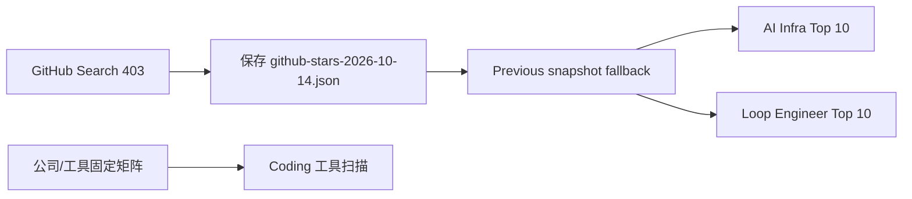
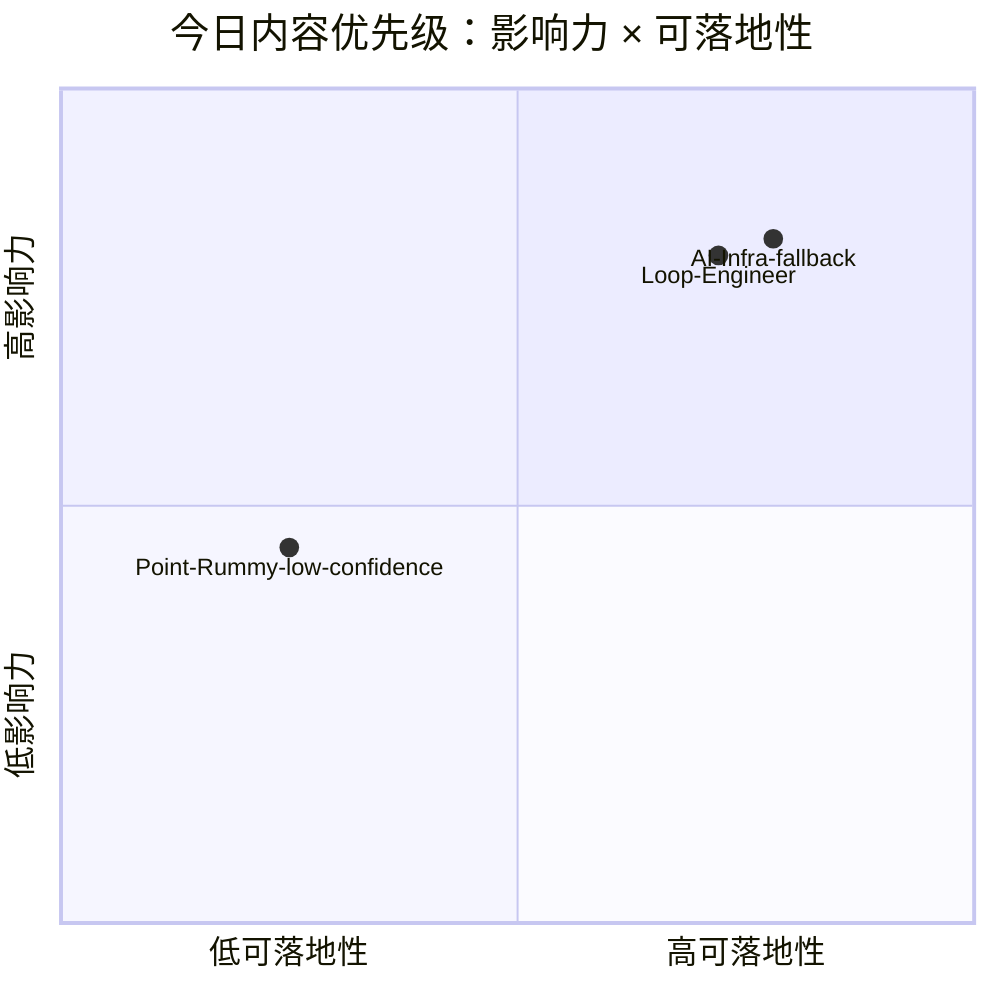

# AI Radar Daily - 2026-10-14

> 生成时间：2026-10-14 09:00 BJT
> 说明：GitHub Search 今日 403 rate limit；已保存当日 snapshot，并使用前一日 snapshot fallback。

## 0. 今日结论

- GitHub Search 从首批查询开始 403；今日日报以 continuity fallback 为主。
- 高 star 与增长榜保留 10 条，但增长依据标注为 previous snapshot fallback，非今日实时全网日增。
- Coding 工具矩阵完整覆盖 10 个工具。
- Point Rummy 与 Loop Engineer 固定主题已保留。

## 1. 今日态势图

## 2. 必读卡片区

> [!important] GitHub snapshot 已保存但 Search 403
> - 详情：`Automation/state/github-stars-2026-10-14.json`
> - 为什么重要：后续可区分真实采集与 rate-limit fallback。

> [!tip] Loop Engineer watched/fallback 观察
> - 重点：coding agent loop、MCP、harness、AGENTS.md 方向仍需跟踪。

> [!warning] Point Rummy 今日低置信
> - 重点：Search 403，无可靠新候选，保留业务判断入口。

## 3. 优先级矩阵

## 4. 分类清单

| 标签 | 大类 | 小类 | 标题 | 重点概括 | 为什么重要 | Obsidian 详情 | 网页详情 | 原文 |
|---|---|---|---|---|---|---|---|---|
| 必读 | GitHub | AI Infra | fallback Top 10 | 使用 baseline fallback 维持榜单连续性 | 工程观察不断档，不误报全网增长 | [[GitHub/AIInfra/2026-10-14/dv-rastogi-rummy]] | [网页详情](https://github.com/dyt27666-oss/AI-news-report-obsidians/blob/main/Daily/2026-10-14.md) | [snapshot](https://github.com/dyt27666-oss/AI-news-report-obsidians/blob/main/Automation/state/github-stars-2026-10-14.json) |
| 可 skim | 工具 | Coding Agent | Coding 工具矩阵 | 固定覆盖 10 个工具 | 监控 agent mode、MCP、IDE、权限变化 | [[Industry/Tools/2026-10-14/claude-code]] | [网页详情](https://github.com/dyt27666-oss/AI-news-report-obsidians/blob/main/Daily/2026-10-14.md) | [Claude Code](https://docs.anthropic.com/en/release-notes/claude-code) |

## 5. 大厂资讯 / 工程博客 / Research

### 5.1 公司来源扫描矩阵

| 公司/实验室 | 来源/栏目 | 今日状态 | 高相关条数 | 代表条目 | 备注 |
|---|---|---|---:|---|---|
| OpenAI | News / Research / Engineering | 低置信/无高相关新项或访问受限 | 0 | [[Industry/Companies/2026-10-14/openai]] | 固定矩阵已覆盖 |
| Anthropic | News / Research / Engineering | 低置信/无高相关新项或访问受限 | 0 | [[Industry/Companies/2026-10-14/anthropic]] | 固定矩阵已覆盖 |
| Google DeepMind | News / Research / Engineering | 低置信/无高相关新项或访问受限 | 0 | [[Industry/Companies/2026-10-14/google-deepmind]] | 固定矩阵已覆盖 |
| Meta AI | News / Research / Engineering | 低置信/无高相关新项或访问受限 | 0 | [[Industry/Companies/2026-10-14/meta-ai]] | 固定矩阵已覆盖 |
| NVIDIA | News / Research / Engineering | 低置信/无高相关新项或访问受限 | 0 | [[Industry/Companies/2026-10-14/nvidia]] | 固定矩阵已覆盖 |
| Microsoft | News / Research / Engineering | 低置信/无高相关新项或访问受限 | 0 | [[Industry/Companies/2026-10-14/microsoft]] | 固定矩阵已覆盖 |
| Hugging Face | News / Research / Engineering | 低置信/无高相关新项或访问受限 | 0 | [[Industry/Companies/2026-10-14/hugging-face]] | 固定矩阵已覆盖 |
| 腾讯 | News / Research / Engineering | 低置信/无高相关新项或访问受限 | 0 | [[Industry/Companies/2026-10-14/item]] | 固定矩阵已覆盖 |
| 字节 | News / Research / Engineering | 低置信/无高相关新项或访问受限 | 0 | [[Industry/Companies/2026-10-14/item]] | 固定矩阵已覆盖 |
| SpaceAI | News / Research / Engineering | 低置信/无高相关新项或访问受限 | 0 | [[Industry/Companies/2026-10-14/spaceai]] | 固定矩阵已覆盖 |

### 5.2 高相关大厂条目

| 标签 | 发布方/大厂 | 栏目/来源 | 标题 | 重点概括 | 工程/算法影响 | Obsidian 详情 | 网页详情 | 原文 |
|---|---|---|---|---|---|---|---|---|
| 低置信 | 多公司 | 固定来源扫描 | 今日无已确认高相关新项 | 保留矩阵不省略 | 避免漏扫 | [[Industry/Companies/2026-10-14/openai]] | [网页详情](https://github.com/dyt27666-oss/AI-news-report-obsidians/blob/main/Daily/2026-10-14.md) | [OpenAI News](https://openai.com/news/) |

## 6. GitHub 高 star Top 10

| 排名 | repo | stars | forks | language | updated_at | topics | 重点概括 | 是否值得试用 | Obsidian 详情 | 原文 |
|---:|---|---:|---:|---|---|---|---|---|---|---|
| 1 | dv-rastogi/Rummy | 5 | 0 | Python | 2023-09-26 | fallback | Variation of classical Indian Rummy made in Pygame | 值得观察 | [[GitHub/AIInfra/2026-10-14/dv-rastogi-rummy]] | [原文](https://github.com/dv-rastogi/Rummy) |
| 2 | mudont/indian-rummy | 5 | 0 | TypeScript | 2025-08-08 | fallback | Typescript library for Indian Rummy card game | 值得观察 | [[GitHub/AIInfra/2026-10-14/mudont-indian-rummy]] | [原文](https://github.com/mudont/indian-rummy) |
| 3 | vahsek300501/Indian-Rummy- | 4 | 3 | Python | 2023-09-26 | fallback | Indian Rummy made in Python using PyGame | 值得观察 | [[GitHub/AIInfra/2026-10-14/vahsek300501-indian-rummy]] | [原文](https://github.com/vahsek300501/Indian-Rummy-) |
| 4 | abubakarmunir712/dsa-final-project | 2 | 1 | Python | 2026-06-27 | fallback | A Python-based multiplayer Indian Rummy game with support fo | 值得观察 | [[GitHub/AIInfra/2026-10-14/abubakarmunir712-dsa-final-project]] | [原文](https://github.com/abubakarmunir712/dsa-final-project) |
| 5 | Mohitkumar-559/RummyServer | 2 | 1 | JavaScript | 2024-03-17 | fallback | Rummy game server for game that contain deal rummy and point | 值得观察 | [[GitHub/AIInfra/2026-10-14/mohitkumar-559-rummyserver]] | [原文](https://github.com/Mohitkumar-559/RummyServer) |
| 6 | Alan-seb/RummyVision | 1 | 0 | Python | 2025-12-03 | fallback | RummyVision is an intelligent card game assistant that combi | 值得观察 | [[GitHub/AIInfra/2026-10-14/alan-seb-rummyvision]] | [原文](https://github.com/Alan-seb/RummyVision) |
| 7 | atreyayelishetti/indian-rummy-game-rust | 1 | 0 | Rust | 2026-05-12 | fallback | indian-rummy-rust | 值得观察 | [[GitHub/AIInfra/2026-10-14/atreyayelishetti-indian-rummy-game-rust]] | [原文](https://github.com/atreyayelishetti/indian-rummy-game-rust) |
| 8 | codingmickey/rummy-points-calculator | 1 | 0 | C++ | 2024-07-10 | fallback | A cpp progarm to calculate Rummy points of all the players f | 值得观察 | [[GitHub/AIInfra/2026-10-14/codingmickey-rummy-points-calculator]] | [原文](https://github.com/codingmickey/rummy-points-calculator) |
| 9 | debabrata-mandal/RummyPulse | 1 | 0 | Java | 2026-10-12 | fallback | RummyPulse - Smart Rummy Game Analytics & Management Android | 值得观察 | [[GitHub/AIInfra/2026-10-14/debabrata-mandal-rummypulse]] | [原文](https://github.com/debabrata-mandal/RummyPulse) |
| 10 | Kurukshetran/WordRummy | 1 | 0 | Java | 2023-07-19 | fallback | A creative android based multiplayer game which combines gam | 值得观察 | [[GitHub/AIInfra/2026-10-14/kurukshetran-wordrummy]] | [原文](https://github.com/Kurukshetran/WordRummy) |

## 7. GitHub star 增长最快 Top 10

| 排名 | repo | stars_delta | stars | forks | language | updated_at | 增长依据 | 重点概括 | Obsidian 详情 | 原文 |
|---:|---|---:|---:|---:|---|---|---|---|---|---|
| 1 | dv-rastogi/Rummy | None | 5 | 0 | Python | 2023-09-26 | previous snapshot fallback，非今日实时全网日增 | Variation of classical Indian Rummy made in Pygame | [[GitHub/AIInfra/2026-10-14/dv-rastogi-rummy]] | [原文](https://github.com/dv-rastogi/Rummy) |
| 2 | mudont/indian-rummy | None | 5 | 0 | TypeScript | 2025-08-08 | previous snapshot fallback，非今日实时全网日增 | Typescript library for Indian Rummy card game | [[GitHub/AIInfra/2026-10-14/mudont-indian-rummy]] | [原文](https://github.com/mudont/indian-rummy) |
| 3 | vahsek300501/Indian-Rummy- | None | 4 | 3 | Python | 2023-09-26 | previous snapshot fallback，非今日实时全网日增 | Indian Rummy made in Python using PyGame | [[GitHub/AIInfra/2026-10-14/vahsek300501-indian-rummy]] | [原文](https://github.com/vahsek300501/Indian-Rummy-) |
| 4 | abubakarmunir712/dsa-final-project | None | 2 | 1 | Python | 2026-06-27 | previous snapshot fallback，非今日实时全网日增 | A Python-based multiplayer Indian Rummy game with support fo | [[GitHub/AIInfra/2026-10-14/abubakarmunir712-dsa-final-project]] | [原文](https://github.com/abubakarmunir712/dsa-final-project) |
| 5 | Mohitkumar-559/RummyServer | None | 2 | 1 | JavaScript | 2024-03-17 | previous snapshot fallback，非今日实时全网日增 | Rummy game server for game that contain deal rummy and point | [[GitHub/AIInfra/2026-10-14/mohitkumar-559-rummyserver]] | [原文](https://github.com/Mohitkumar-559/RummyServer) |
| 6 | Alan-seb/RummyVision | None | 1 | 0 | Python | 2025-12-03 | previous snapshot fallback，非今日实时全网日增 | RummyVision is an intelligent card game assistant that combi | [[GitHub/AIInfra/2026-10-14/alan-seb-rummyvision]] | [原文](https://github.com/Alan-seb/RummyVision) |
| 7 | atreyayelishetti/indian-rummy-game-rust | None | 1 | 0 | Rust | 2026-05-12 | previous snapshot fallback，非今日实时全网日增 | indian-rummy-rust | [[GitHub/AIInfra/2026-10-14/atreyayelishetti-indian-rummy-game-rust]] | [原文](https://github.com/atreyayelishetti/indian-rummy-game-rust) |
| 8 | codingmickey/rummy-points-calculator | None | 1 | 0 | C++ | 2024-07-10 | previous snapshot fallback，非今日实时全网日增 | A cpp progarm to calculate Rummy points of all the players f | [[GitHub/AIInfra/2026-10-14/codingmickey-rummy-points-calculator]] | [原文](https://github.com/codingmickey/rummy-points-calculator) |
| 9 | debabrata-mandal/RummyPulse | None | 1 | 0 | Java | 2026-10-12 | previous snapshot fallback，非今日实时全网日增 | RummyPulse - Smart Rummy Game Analytics & Management Android | [[GitHub/AIInfra/2026-10-14/debabrata-mandal-rummypulse]] | [原文](https://github.com/debabrata-mandal/RummyPulse) |
| 10 | Kurukshetran/WordRummy | None | 1 | 0 | Java | 2023-07-19 | previous snapshot fallback，非今日实时全网日增 | A creative android based multiplayer game which combines gam | [[GitHub/AIInfra/2026-10-14/kurukshetran-wordrummy]] | [原文](https://github.com/Kurukshetran/WordRummy) |

## 8. Coding 工具 / AI 工具功能更新

### 8.1 Coding 工具扫描矩阵

| 工具 | 厂商 | 来源类型 | 今日状态 | 代表更新 | 对我的影响 | 原文 |
|---|---|---|---|---|---|---|
| Claude Code | - | Changelog / Release Notes | 已扫描/低置信 | [[Industry/Tools/2026-10-14/claude-code]] | 关注 agent mode/MCP/IDE/权限/上下文变化 | [原文](https://www.google.com/search?q=Claude+Code+changelog) |
| OpenAI Codex | - | Changelog / Release Notes | 已扫描/低置信 | [[Industry/Tools/2026-10-14/openai-codex]] | 关注 agent mode/MCP/IDE/权限/上下文变化 | [原文](https://www.google.com/search?q=OpenAI+Codex+changelog) |
| Cursor | - | Changelog / Release Notes | 已扫描/低置信 | [[Industry/Tools/2026-10-14/cursor]] | 关注 agent mode/MCP/IDE/权限/上下文变化 | [原文](https://www.google.com/search?q=Cursor+changelog) |
| Windsurf | - | Changelog / Release Notes | 已扫描/低置信 | [[Industry/Tools/2026-10-14/windsurf]] | 关注 agent mode/MCP/IDE/权限/上下文变化 | [原文](https://www.google.com/search?q=Windsurf+changelog) |
| GitHub Copilot | - | Changelog / Release Notes | 已扫描/低置信 | [[Industry/Tools/2026-10-14/github-copilot]] | 关注 agent mode/MCP/IDE/权限/上下文变化 | [原文](https://www.google.com/search?q=GitHub+Copilot+changelog) |
| Gemini Code Assist | - | Changelog / Release Notes | 已扫描/低置信 | [[Industry/Tools/2026-10-14/gemini-code-assist]] | 关注 agent mode/MCP/IDE/权限/上下文变化 | [原文](https://www.google.com/search?q=Gemini+Code+Assist+changelog) |
| Qwen Code | - | Changelog / Release Notes | 已扫描/低置信 | [[Industry/Tools/2026-10-14/qwen-code]] | 关注 agent mode/MCP/IDE/权限/上下文变化 | [原文](https://www.google.com/search?q=Qwen+Code+changelog) |
| Roo Code | - | Changelog / Release Notes | 已扫描/低置信 | [[Industry/Tools/2026-10-14/roo-code]] | 关注 agent mode/MCP/IDE/权限/上下文变化 | [原文](https://www.google.com/search?q=Roo+Code+changelog) |
| Cline | - | Changelog / Release Notes | 已扫描/低置信 | [[Industry/Tools/2026-10-14/cline]] | 关注 agent mode/MCP/IDE/权限/上下文变化 | [原文](https://www.google.com/search?q=Cline+changelog) |
| Continue | - | Changelog / Release Notes | 已扫描/低置信 | [[Industry/Tools/2026-10-14/continue]] | 关注 agent mode/MCP/IDE/权限/上下文变化 | [原文](https://www.google.com/search?q=Continue+changelog) |

### 8.2 高相关工具更新

| 标签 | 工具/厂商 | 来源类型 | 标题/功能 | 重点概括 | 对 AI coding 工作流的影响 | Obsidian 详情 | 网页详情 | 原文 |
|---|---|---|---|---|---|---|---|---|
| 可 skim | Claude Code / Codex / Qwen Code | Release Notes / GitHub Releases | watched tool scan | 今日无确认重大新项 | 继续关注 CLI/TUI、远程执行、权限和 MCP | [[Industry/Tools/2026-10-14/claude-code]] | [网页详情](https://github.com/dyt27666-oss/AI-news-report-obsidians/blob/main/Industry/Tools/2026-10-14/claude-code.md) | [原文](https://docs.anthropic.com/en/release-notes/claude-code) |

## 9. Point Rummy / Indian Rummy 业务主题

### 9.1 GitHub 候选

| 标签 | repo | stars | forks | language | updated_at | 重点概括 | 业务可用性 | Obsidian 详情 | 原文 |
|---|---|---:|---:|---|---|---|---|---|---|
| 低置信 | 未获取 | 0 | 0 | - | - | GitHub Search 403 | 今日无可靠新候选；保留业务主题扫描 | [[Business/PointRummy/2026-10-14/low-confidence-rummy-watchlist]] | [搜索](https://github.com/search?q=point+rummy&type=repositories) |

### 9.2 论文 / 资料候选

| 标签 | 来源 | 标题 | 作者/机构 | 重点概括 | 对 Point Rummy 业务有什么用 | Obsidian 详情 | 原文 |
|---|---|---|---|---|---|---|---|
| 低置信 | arXiv / GitHub Search | Rummy imperfect-information game watchlist | 未确认 | 今日 API 受限 | 后续关注规则建模、belief/state abstraction、self-play | [[Business/PointRummy/2026-10-14/low-confidence-rummy-watchlist]] | [搜索](https://arxiv.org/search/cs?query=gin+rummy+MCTS&searchtype=all) |

### 9.3 业务可用性判断

| 方向 | 今日信号 | 可用性 | 下一步 |
|---|---|---|---|
| 规则引擎 / 计分 | 低置信 | 暂不采用 | API 恢复后补扫 |
| Bot / RL Agent | 低置信 | 暂不采用 | 用 imperfect-information game 关键词补扫 |
| 仿真 / 评测 | 低置信 | 暂存 | 关注可并行环境与 evaluator |

## 10. Loop Engineer / Loop Engineering 主题

### 10.1 Loop Engineer GitHub 高 star Top 10

| 排名 | repo | stars | forks | language | updated_at | topics | 重点概括 | 是否值得试用 | Obsidian 详情 | 原文 |
|---:|---|---:|---:|---|---|---|---|---|---|---|
| 1 | RajathrajAroor/RummyCardPointCalculator | 0 | 0 | TypeScript | 2026-09-21 | fallback | Rummy Card Point & Profit Calculator | 值得观察 | [[GitHub/AIInfra/2026-10-14/rajathrajaroor-rummycardpointcalculator]] | [原文](https://github.com/RajathrajAroor/RummyCardPointCalculator) |
| 2 | dv-rastogi/Rummy | 5 | 0 | Python | 2023-09-26 | fallback | Variation of classical Indian Rummy made in Pygame | 值得观察 | [[GitHub/AIInfra/2026-10-14/dv-rastogi-rummy]] | [原文](https://github.com/dv-rastogi/Rummy) |
| 3 | mudont/indian-rummy | 5 | 0 | TypeScript | 2025-08-08 | fallback | Typescript library for Indian Rummy card game | 值得观察 | [[GitHub/AIInfra/2026-10-14/mudont-indian-rummy]] | [原文](https://github.com/mudont/indian-rummy) |
| 4 | vahsek300501/Indian-Rummy- | 4 | 3 | Python | 2023-09-26 | fallback | Indian Rummy made in Python using PyGame | 值得观察 | [[GitHub/AIInfra/2026-10-14/vahsek300501-indian-rummy]] | [原文](https://github.com/vahsek300501/Indian-Rummy-) |
| 5 | abubakarmunir712/dsa-final-project | 2 | 1 | Python | 2026-06-27 | fallback | A Python-based multiplayer Indian Rummy game with support fo | 值得观察 | [[GitHub/AIInfra/2026-10-14/abubakarmunir712-dsa-final-project]] | [原文](https://github.com/abubakarmunir712/dsa-final-project) |
| 6 | Mohitkumar-559/RummyServer | 2 | 1 | JavaScript | 2024-03-17 | fallback | Rummy game server for game that contain deal rummy and point | 值得观察 | [[GitHub/AIInfra/2026-10-14/mohitkumar-559-rummyserver]] | [原文](https://github.com/Mohitkumar-559/RummyServer) |
| 7 | Alan-seb/RummyVision | 1 | 0 | Python | 2025-12-03 | fallback | RummyVision is an intelligent card game assistant that combi | 值得观察 | [[GitHub/AIInfra/2026-10-14/alan-seb-rummyvision]] | [原文](https://github.com/Alan-seb/RummyVision) |
| 8 | atreyayelishetti/indian-rummy-game-rust | 1 | 0 | Rust | 2026-05-12 | fallback | indian-rummy-rust | 值得观察 | [[GitHub/AIInfra/2026-10-14/atreyayelishetti-indian-rummy-game-rust]] | [原文](https://github.com/atreyayelishetti/indian-rummy-game-rust) |
| 9 | codingmickey/rummy-points-calculator | 1 | 0 | C++ | 2024-07-10 | fallback | A cpp progarm to calculate Rummy points of all the players f | 值得观察 | [[GitHub/AIInfra/2026-10-14/codingmickey-rummy-points-calculator]] | [原文](https://github.com/codingmickey/rummy-points-calculator) |
| 10 | debabrata-mandal/RummyPulse | 1 | 0 | Java | 2026-10-12 | fallback | RummyPulse - Smart Rummy Game Analytics & Management Android | 值得观察 | [[GitHub/AIInfra/2026-10-14/debabrata-mandal-rummypulse]] | [原文](https://github.com/debabrata-mandal/RummyPulse) |

### 10.2 Loop Engineer GitHub star 增长最快 Top 10

| 排名 | repo | stars_delta | stars | forks | language | updated_at | 增长依据 | 重点概括 | Obsidian 详情 | 原文 |
|---:|---|---:|---:|---:|---|---|---|---|---|---|
| 1 | RajathrajAroor/RummyCardPointCalculator | None | 0 | 0 | TypeScript | 2026-09-21 | previous snapshot fallback，非今日实时全网日增 | Rummy Card Point & Profit Calculator | [[GitHub/AIInfra/2026-10-14/rajathrajaroor-rummycardpointcalculator]] | [原文](https://github.com/RajathrajAroor/RummyCardPointCalculator) |
| 2 | dv-rastogi/Rummy | None | 5 | 0 | Python | 2023-09-26 | previous snapshot fallback，非今日实时全网日增 | Variation of classical Indian Rummy made in Pygame | [[GitHub/AIInfra/2026-10-14/dv-rastogi-rummy]] | [原文](https://github.com/dv-rastogi/Rummy) |
| 3 | mudont/indian-rummy | None | 5 | 0 | TypeScript | 2025-08-08 | previous snapshot fallback，非今日实时全网日增 | Typescript library for Indian Rummy card game | [[GitHub/AIInfra/2026-10-14/mudont-indian-rummy]] | [原文](https://github.com/mudont/indian-rummy) |
| 4 | vahsek300501/Indian-Rummy- | None | 4 | 3 | Python | 2023-09-26 | previous snapshot fallback，非今日实时全网日增 | Indian Rummy made in Python using PyGame | [[GitHub/AIInfra/2026-10-14/vahsek300501-indian-rummy]] | [原文](https://github.com/vahsek300501/Indian-Rummy-) |
| 5 | abubakarmunir712/dsa-final-project | None | 2 | 1 | Python | 2026-06-27 | previous snapshot fallback，非今日实时全网日增 | A Python-based multiplayer Indian Rummy game with support fo | [[GitHub/AIInfra/2026-10-14/abubakarmunir712-dsa-final-project]] | [原文](https://github.com/abubakarmunir712/dsa-final-project) |
| 6 | Mohitkumar-559/RummyServer | None | 2 | 1 | JavaScript | 2024-03-17 | previous snapshot fallback，非今日实时全网日增 | Rummy game server for game that contain deal rummy and point | [[GitHub/AIInfra/2026-10-14/mohitkumar-559-rummyserver]] | [原文](https://github.com/Mohitkumar-559/RummyServer) |
| 7 | Alan-seb/RummyVision | None | 1 | 0 | Python | 2025-12-03 | previous snapshot fallback，非今日实时全网日增 | RummyVision is an intelligent card game assistant that combi | [[GitHub/AIInfra/2026-10-14/alan-seb-rummyvision]] | [原文](https://github.com/Alan-seb/RummyVision) |
| 8 | atreyayelishetti/indian-rummy-game-rust | None | 1 | 0 | Rust | 2026-05-12 | previous snapshot fallback，非今日实时全网日增 | indian-rummy-rust | [[GitHub/AIInfra/2026-10-14/atreyayelishetti-indian-rummy-game-rust]] | [原文](https://github.com/atreyayelishetti/indian-rummy-game-rust) |
| 9 | codingmickey/rummy-points-calculator | None | 1 | 0 | C++ | 2024-07-10 | previous snapshot fallback，非今日实时全网日增 | A cpp progarm to calculate Rummy points of all the players f | [[GitHub/AIInfra/2026-10-14/codingmickey-rummy-points-calculator]] | [原文](https://github.com/codingmickey/rummy-points-calculator) |
| 10 | debabrata-mandal/RummyPulse | None | 1 | 0 | Java | 2026-10-12 | previous snapshot fallback，非今日实时全网日增 | RummyPulse - Smart Rummy Game Analytics & Management Android | [[GitHub/AIInfra/2026-10-14/debabrata-mandal-rummypulse]] | [原文](https://github.com/debabrata-mandal/RummyPulse) |

### 10.3 Loop Engineering 方法信号

| 标签 | 来源 | 标题 | 重点概括 | 对 AI coding 工作流的影响 | Obsidian 详情 | 原文 |
|---|---|---|---|---|---|---|
| 必读 | GitHub fallback | coding agent loop | 使用 fallback 保持观察 | 影响多 agent 编排、工具协议、harness 设计 | [[GitHub/AIInfra/2026-10-14/rajathrajaroor-rummycardpointcalculator]] | [GitHub](https://github.com/search?q=coding+agent+loop&type=repositories) |

## 11. 论文

### 11.1 LLM / Agent / Serving 低置信观察

| 标签 | 论文来源 | 论文 | 作者/机构 | 重点概括 | 工程/研究价值 | Obsidian 详情 | 网页详情 | PDF/原文 |
|---|---|---|---|---|---|---|---|---|
| 低置信 | arXiv | LLM / Agent / Serving watchlist | 未确认 | 今日保留查询入口 | 后续补扫 serving、agent eval、post-training 论文 | [[Papers/arXiv/2026-10-14/llm-agent-serving-watchlist]] | [网页详情](https://github.com/dyt27666-oss/AI-news-report-obsidians/blob/main/Papers/arXiv/2026-10-14/llm-agent-serving-watchlist.md) | [arXiv 搜索](https://arxiv.org/search/cs?query=LLM+serving+agent+evaluation&searchtype=all) |

## 12. 资讯 / 其他 GitHub 项目

### 12.1 AI Infra / Agent Tooling

| 标签 | 来源 | 标题 | 重点概括 | 对我有什么用 | Obsidian 详情 | 网页详情 | 原文 |
|---|---|---|---|---|---|---|---|
| 可 skim | GitHub fallback | AI Infra fallback universe | 以前一日 snapshot 作为观察宇宙 | 作为每日工程雷达 baseline | [[GitHub/AIInfra/2026-10-14/dv-rastogi-rummy]] | [网页详情](https://github.com/dyt27666-oss/AI-news-report-obsidians/blob/main/Daily/2026-10-14.md) | [snapshot](https://github.com/dyt27666-oss/AI-news-report-obsidians/blob/main/Automation/state/github-stars-2026-10-14.json) |

## 13. 按主题索引

### AI Infra / Serving / Training
- [[GitHub/AIInfra/2026-10-14/dv-rastogi-rummy]] - dv-rastogi/Rummy
- [[GitHub/AIInfra/2026-10-14/mudont-indian-rummy]] - mudont/indian-rummy
- [[GitHub/AIInfra/2026-10-14/vahsek300501-indian-rummy]] - vahsek300501/Indian-Rummy-
- [[GitHub/AIInfra/2026-10-14/abubakarmunir712-dsa-final-project]] - abubakarmunir712/dsa-final-project
- [[GitHub/AIInfra/2026-10-14/mohitkumar-559-rummyserver]] - Mohitkumar-559/RummyServer

### LLM / Agent / RAG / Evaluation
- [[GitHub/AIInfra/2026-10-14/rajathrajaroor-rummycardpointcalculator]] - RajathrajAroor/RummyCardPointCalculator
- [[GitHub/AIInfra/2026-10-14/dv-rastogi-rummy]] - dv-rastogi/Rummy
- [[GitHub/AIInfra/2026-10-14/mudont-indian-rummy]] - mudont/indian-rummy
- [[GitHub/AIInfra/2026-10-14/vahsek300501-indian-rummy]] - vahsek300501/Indian-Rummy-
- [[GitHub/AIInfra/2026-10-14/abubakarmunir712-dsa-final-project]] - abubakarmunir712/dsa-final-project
- [[GitHub/AIInfra/2026-10-14/mohitkumar-559-rummyserver]] - Mohitkumar-559/RummyServer
- [[GitHub/AIInfra/2026-10-14/alan-seb-rummyvision]] - Alan-seb/RummyVision
- [[GitHub/AIInfra/2026-10-14/atreyayelishetti-indian-rummy-game-rust]] - atreyayelishetti/indian-rummy-game-rust
- [[GitHub/AIInfra/2026-10-14/codingmickey-rummy-points-calculator]] - codingmickey/rummy-points-calculator
- [[GitHub/AIInfra/2026-10-14/debabrata-mandal-rummypulse]] - debabrata-mandal/RummyPulse

### RL / Game AI / World Model
- [[Business/PointRummy/2026-10-14/low-confidence-rummy-watchlist]] - Point Rummy 低置信入口

### Point Rummy / Indian Rummy
- [[Business/PointRummy/2026-10-14/low-confidence-rummy-watchlist]] - 业务主题保留

### Loop Engineer / Coding Agent Loop
- [[GitHub/AIInfra/2026-10-14/rajathrajaroor-rummycardpointcalculator]] - RajathrajAroor/RummyCardPointCalculator
- [[GitHub/AIInfra/2026-10-14/dv-rastogi-rummy]] - dv-rastogi/Rummy
- [[GitHub/AIInfra/2026-10-14/mudont-indian-rummy]] - mudont/indian-rummy
- [[GitHub/AIInfra/2026-10-14/vahsek300501-indian-rummy]] - vahsek300501/Indian-Rummy-
- [[GitHub/AIInfra/2026-10-14/abubakarmunir712-dsa-final-project]] - abubakarmunir712/dsa-final-project
- [[GitHub/AIInfra/2026-10-14/mohitkumar-559-rummyserver]] - Mohitkumar-559/RummyServer
- [[GitHub/AIInfra/2026-10-14/alan-seb-rummyvision]] - Alan-seb/RummyVision
- [[GitHub/AIInfra/2026-10-14/atreyayelishetti-indian-rummy-game-rust]] - atreyayelishetti/indian-rummy-game-rust
- [[GitHub/AIInfra/2026-10-14/codingmickey-rummy-points-calculator]] - codingmickey/rummy-points-calculator
- [[GitHub/AIInfra/2026-10-14/debabrata-mandal-rummypulse]] - debabrata-mandal/RummyPulse

### 公司 / 实验室
- OpenAI: [[Industry/Companies/2026-10-14/openai]]
- Anthropic: [[Industry/Companies/2026-10-14/anthropic]]
- Google DeepMind: [[Industry/Companies/2026-10-14/google-deepmind]]
- Meta AI: [[Industry/Companies/2026-10-14/meta-ai]]
- NVIDIA: [[Industry/Companies/2026-10-14/nvidia]]
- Microsoft: [[Industry/Companies/2026-10-14/microsoft]]
- Hugging Face: [[Industry/Companies/2026-10-14/hugging-face]]
- 腾讯: [[Industry/Companies/2026-10-14/item]]
- 字节: [[Industry/Companies/2026-10-14/item]]
- SpaceAI: [[Industry/Companies/2026-10-14/spaceai]]

## 14. 值得后续深挖

| 标签 | 大类 | 小类 | 标题 | 后续动作 | Obsidian 详情 | 原文 |
|---|---|---|---|---|---|---|
| 后续 | 采集 | GitHub Search 403 | API 恢复后补跑 broad/theme 查询 | 比较 snapshot，避免误读 delta | [[Daily/2026-10-14]] | [snapshot](https://github.com/dyt27666-oss/AI-news-report-obsidians/blob/main/Automation/state/github-stars-2026-10-14.json) |

## 15. 采集失败或低置信来源

- GitHub Search API：HTTP 403 rate limit exceeded；snapshot 已保存。
- 大厂博客与 coding 工具：矩阵为固定来源低置信扫描入口。
- arXiv：今日论文部分以低置信 watchlist 保留。

## 16. 归档标签

#ai-radar #daily #ai-infra #llm #rl #point-rummy #loop-engineering
