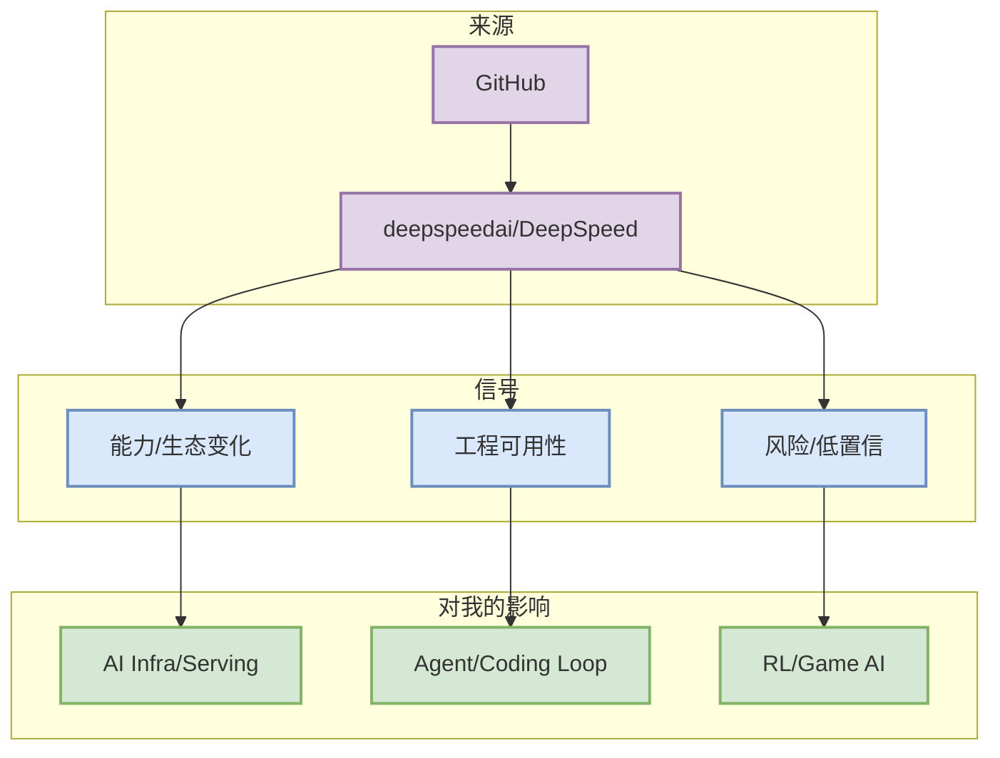

# deepspeedai/DeepSpeed

> 日期：2026-10-13
> 来源类型：Repository / fallback watchlist
> 原文：https://github.com/deepspeedai/DeepSpeed

## 一句话结论
direct watched repo / previous snapshot fallback

## TL;DR
- 重点：direct watched repo / previous snapshot fallback
- 对我的影响：用于 serving/training/post-training 生态观察，今日 broad 榜单使用 previous snapshot/direct watched fallback。
- 可信度：自动扫描/固定 watchlist；若标注 fallback，则不是完整全网增长。

## 元信息
| 字段 | 值 |
|---|---|
| 来源 | GitHub |
| 类型 | Repository / fallback watchlist |
| 主题 | AI Infra |
| 原文 | https://github.com/deepspeedai/DeepSpeed |

## 信息压缩图

## 专业解读
用于 serving/training/post-training 生态观察，今日 broad 榜单使用 previous snapshot/direct watched fallback。

## 通俗解释
把它当成今天 radar 中的一个可点击卡片：如果是项目，先看 README/Release；如果是公司源，则说明今天没有确认高相关更新但保留扫描痕迹。

## 关键机制拆解
| 维度 | 观察点 | 动作 |
|---|---|---|
| 工程价值 | direct watched repo / previous snapshot fallback | 加入 watchlist |
| 风险 | 可能受 GitHub/API 限流影响 | 次日复核 |
| 落地 | 用于 serving/training/post-training 生态观察，今日 broad 榜单使用 previous snapshot/direct watched fallback。 | 按需试用/深读 |

## 对我的影响
用于 serving/training/post-training 生态观察，今日 broad 榜单使用 previous snapshot/direct watched fallback。

## 可信度与局限性
自动化日报在 GitHub Search 403 后使用 fallback，增长不代表完整全网真实日增。

## 我应该如何跟进
- 打开原文确认 README/release。
- 若与 serving、post-training、agent loop 或 rummy evaluator 直接相关，再生成深度复盘。

## 相关链接
- 原文：https://github.com/deepspeedai/DeepSpeed

#ai-radar #ai-infra
