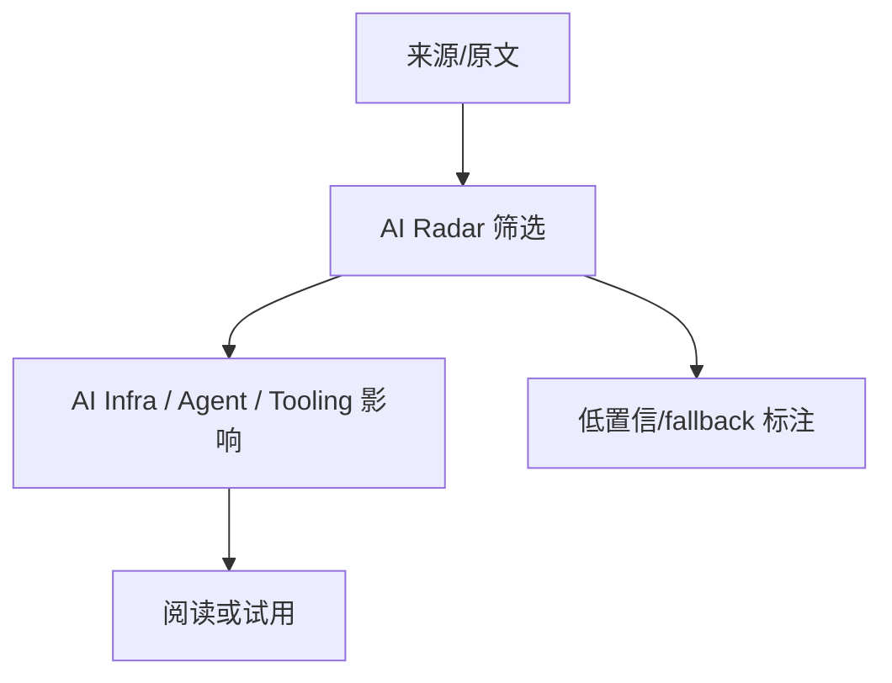

# atreyayelishetti/indian-rummy-game-rust

> 类型：AI Radar 详情
> 创建日期：2026-10-14
> 原文链接：https://github.com/atreyayelishetti/indian-rummy-game-rust
> 返回日报：[[Daily/2026-10-14]]

## 一句话结论

atreyayelishetti/indian-rummy-game-rust 是今日 AI Radar 在 GitHub Search 403 背景下保留的观察条目。

## TL;DR

- 今日数据部分来自 fallback，不代表完整全网实时增长。
- 对 AI Infra / coding agent / 工具链有观察价值。
- 建议后续在 API 恢复后复核。

## 信息压缩图示

## 关键机制拆解

| 机制 | 价值 | 风险 |
|---|---|---|
| 来源留痕 | 可回溯 | API 受限 |
| fallback | 日报不断档 | 非完整实时排名 |

## 相关链接

- 原文：https://github.com/atreyayelishetti/indian-rummy-game-rust

#ai-radar
