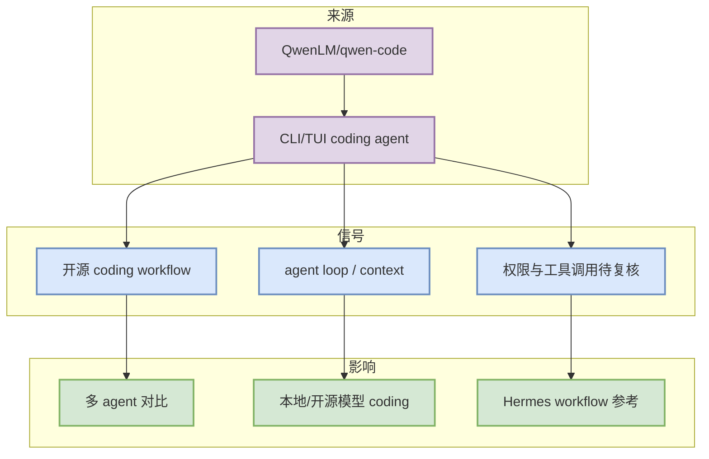

# QwenLM/qwen-code

> 日期：2026-10-13
> 来源类型：Repository / Loop Engineer watchlist
> 原文：https://github.com/QwenLM/qwen-code

## 一句话结论
Qwen Code 作为开源 coding-agent/CLI 观察对象，补足 Loop Engineer 固定 Top 10。

## TL;DR
- 重点：用于观察 CLI/TUI、agent loop、上下文工程与开源模型 coding workflow。
- 对我的影响：可与 Claude Code、Codex、Gemini CLI、Cline/Roo/Continue 横向比较。
- 可信度：fallback 补位；增长不是完整全网日增。

## 元信息
| 字段 | 值 |
|---|---|
| 来源 | GitHub |
| 类型 | Repository / Loop Engineer watchlist |
| 主题 | Loop Engineer |
| 原文 | https://github.com/QwenLM/qwen-code |

## 信息压缩图

## 专业解读
Qwen Code 属于 Loop Engineer 工具矩阵的一部分，适合观察开源 coding agent 如何处理上下文、文件编辑、命令执行、权限与模型接入。

## 通俗解释
它是今天用于补齐 coding-agent loop 榜单的一个固定观察对象，不代表今天真实增长。

## 关键机制拆解
| 维度 | 观察点 | 动作 |
|---|---|---|
| Agent loop | CLI/TUI 与工具调用 | 后续看 release notes |
| 上下文 | 文件/项目级上下文 | 与 Claude Code/Codex 对比 |
| 风险 | fallback 补位 | 明日复核真实 metadata |

## 对我的影响
可作为开源 coding workflow 和多 agent 工具链的对照样本。

## 可信度与局限性
今日 GitHub Search 受限，此页为固定 watchlist 补位详情。

## 我应该如何跟进
- 查看 release notes 与 README。
- 对比 Claude Code / Codex / Gemini CLI 的权限和上下文策略。

## 相关链接
- 原文：https://github.com/QwenLM/qwen-code

#ai-radar #loop-engineer
