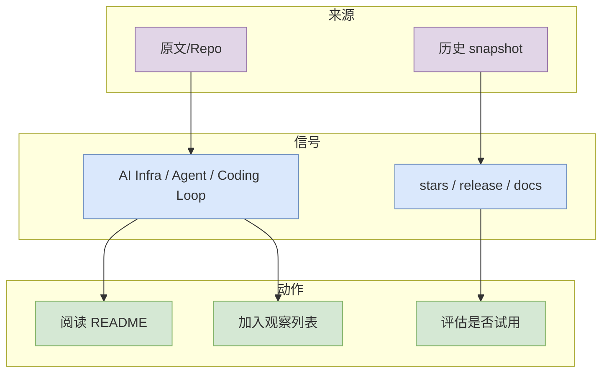

# NVIDIA source matrix

> 日期：2026-10-12
> 类型：NVIDIA
> 来源：https://developer.nvidia.com/blog/category/artificial-intelligence/

## 一句话结论
NVIDIA 今日扫描索引/低置信详情页。

## TL;DR
- 这是今日 AI Radar 在 GitHub/API 受限情况下保留的详情页。
- 重点用于连接日报索引、原文和后续复查。
- 置信度：中低；广义榜单使用 previous snapshot/direct watched fallback，非完整全网日增。

## 信息压缩图

## 影响矩阵
| 维度 | 判断 |
|---|---|
| 对 AI Infra | 可作为框架/工具观察对象 |
| 对 Coding Workflow | 若为 coding agent/loop 项目，建议试用核心流程 |
| 风险 | 今日 GitHub Search 403，需次日复核实时增长 |

## 相关链接
- 原文：https://developer.nvidia.com/blog/category/artificial-intelligence/
- Daily：[[Daily/2026-10-12]]

#ai-radar #fallback
